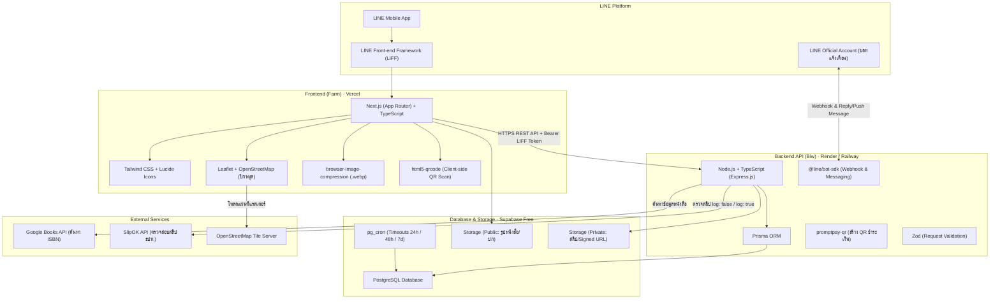

# GongDong (กองดอง) — Tech Stack & Architecture

> **เวอร์ชัน:** 1.0.0 (MVP Hackathon 2569)  
> **อัปเดตล่าสุด:** 12 พ.ย. 2569  
> **ผู้ร่วมจัดทำ:** Biw (Backend) & Farm (Frontend) ร่วมกับ Ditchaphon (PM)  
> **ปรัชญาการออกแบบ:** **Zero-Cost Development**, **TypeScript End-to-End**, **Type-Safe**, และ **Mobile-First บน LINE Ecosystem**

---

## 1. ภาพรวมสถาปัตยกรรมระบบ (System Architecture Overview)



---

## 2. ฝั่งหน้าบ้าน (Frontend Tech Stack)

**ผู้รับผิดชอบ:** Farm  
**โฟลเดอร์หลัก:** `frontend/`  
**แนวคิด:** หน้าจอทั้งหมดทำงานบนมือถือผ่าน LINE LIFF (Mobile-First) รวดเร็ว น้ำหนักเบา และประหยัด Bandwidth

| ส่วนงาน | เทคโนโลยีที่เลือก | เหตุผลและหน้าที่ในระบบ |
|---|---|---|
| **Core Framework** | **Next.js (v14/v15 App Router)** | รองรับ React Server Components, Fast Refresh, Route Handler และเป็นมาตรฐานระดับ Production |
| **Language** | **TypeScript** | ควบคุม Data Type ป้องกันบั๊กตั้งแต่ตอนพัฒนา และ Sync Types กับ Backend API Contract ได้แม่นยำ |
| **Styling & UI** | **Tailwind CSS** + **Lucide React** | จัดการดีไซน์ได้รวดเร็วตาม Figma ทำ Responsive บนมือถือสะดวก ขนาดไฟล์ CSS เล็ก |
| **LINE Integration** | **@line/liff** | SDK หลักสำหรับดึง LINE Profile, ID Token, และคำสั่ง `liff.sendMessages()` เพื่อส่งข้อความเข้าห้องแชท OA |
| **แผนที่ & จุดนัดรับ** | **Leaflet + React-Leaflet** (OpenStreetMap) | **ฟรี 100% ไม่ต้องผูกบัตรเครดิต** น้ำหนักเบา สำหรับฟีเจอร์ปักหมุดพิกัดจุดนัดพบอิสระ (Lat/Lng) |
| **การจัดการรูปภาพ** | **browser-image-compression** | ย่อรูปถ่ายจากมือถือให้กว้างไม่เกิน 1080px และแปลงเป็น `.webp` (~100–200 KB) ก่อนส่งขึ้น Server ช่วยประหยัด Supabase Storage (Free Tier 1 GB) ให้เก็บได้ 1,000+ เล่ม |
| **สแกนบาร์โค้ด ISBN (1D Barcode)** | **html5-qrcode** (ทางเลือกหลัก) หรือ **@zxing/browser** | เปิดกล้องมือถือใน LIFF สแกนบาร์โค้ด 1 มิติ มาตรฐาน **EAN-13 (ISBN 13 หลัก)** บนหลังปกหนังสือ แล้วส่งรหัสไปค้นหาข้อมูลจาก Google Books API อัตโนมัติ (พร้อม Fallback ให้พิมพ์ ISBN หรือชื่อหนังสือเอง) |
| **ตรวจสลิปเบื้องต้น (2D QR)** | **html5-qrcode** หรือ **jsQR** | สแกนหา QR Code ในรูปสลิปและถอด Payload ฝั่ง Client เพื่อเช็กเบื้องต้นก่อนยิงไป Backend ช่วยเซฟโควต้า SlipOK ฟรี (ใช้ `html5-qrcode` ตัวเดียวจบได้ทั้ง Barcode 1D และ QR 2D) |
| **State & Data Fetching** | **TanStack Query (React Query)** หรือ Native `fetch` | จัดการ Caching, Refetching และสถานะ Loading/Error ได้อย่างลื่นไหล |
| **Hosting & Deployment** | **Vercel** | เชื่อม Git Deploy อัตโนมัติ ได้ HTTPS ทันทีตามเงื่อนไขบังคับของ LIFF Endpoint URL |

### 2.1 โฟลว์การสแกน ISBN (1D Barcode) และการเลือกใช้ Library

```
[ผู้ขายเปิดกล้องใน LIFF]
       │
       ▼
[html5-qrcode / @zxing/browser] ──(ตรวจจับบาร์โค้ด EAN-13 บนหลังปก)
       │ ได้รับรหัส 13 หลัก (เช่น 97861608...)
       ▼
[Next.js Frontend] ──GET /api/books/isbn/:isbn──► [Backend Express API]
                                                         │
                                                         ▼
[ฟอร์มลงขาย S2 กรอกข้อมูลอัตโนมัติ] ◄──ส่ง JSON กลับ── [Google Books API]
 (ชื่อเรื่อง, ผู้แต่ง, สำนักพิมพ์, ลิงก์รูปปก)       (q=isbn:<ISBN>)
```

#### การเปรียบเทียบระหว่าง `html5-qrcode` vs `@zxing/browser`:
* **ข้อแนะนำหลัก (Recommended): ใช้ `html5-qrcode`**
  * **เหตุผล:** พัฒนาต่อยอดบน ZXing โดยตรง รองรับทั้งบาร์โค้ด 1 มิติ (`Html5QrcodeSupportedFormats.EAN_13`, `EAN_8`, `CODE_128`) และ 2 มิติ (`QR_CODE`) 
  * **จุดเด่น:** ติดตั้งไลบรารีตัวเดียวจบได้ทั้งระบบ (One Library for Both Scanners) คือใช้ทั้ง **สแกนบาร์โค้ดหนังสือ (ผู้ขาย)** และ **สแกนถอดรหัส QR สลิป (ผู้ซื้อ)** โดยไม่ต้องโหลดหลายไลบรารีให้เพิ่มขนาด Bundle
  * มี UI สำเร็จรูปและจัดการ Permission กล้องใน In-App Browser ของ LINE (LIFF) บน iOS/Android ได้เสถียร
* **ทางเลือกสำรอง: `@zxing/browser`**
  * เหมาะหากต้องการ Custom Video Stream เองทั้งหมด และควบคุม Canvas / Bounding Box เองในระดับลึก
* **มาตรการ Fallback (สำคัญมาก):**
  * กล้องมือถือรุ่นเก่าหรือแสงน้อยอาจจับบาร์โค้ดเส้นยาก ระบบจึงต้องมีช่อง **"พิมพ์เลข ISBN 10/13 หลัก หรือพิมพ์ชื่อหนังสือเอง"** ควบคู่กันเสมอตามข้อกำหนดใน User Flow v4

---

## 3. ฝั่งหลังบ้าน (Backend Tech Stack)

**ผู้รับผิดชอบ:** Biw  
**โฟลเดอร์หลัก:** `backend/`  
**แนวคิด:** สถาปัตยกรรม Modular, Type-Safe, ปลอดภัย (RLS / Data Masking) และประหยัดค่าใช้จ่าย (Zero Cost)

| ส่วนงาน | เทคโนโลยีที่เลือก | เหตุผลและหน้าที่ในระบบ |
|---|---|---|
| **Runtime Environment** | **Node.js (LTS v20+)** | รันเสถียร มี Ecosystem ของแพ็กเกจรองรับ LINE API ครบถ้วนที่สุด |
| **Language** | **TypeScript** | Type-safe ตลอดทั้ง Request Lifecycle และสามารถเชื่อมโยง Type กับ Prisma และ Frontend |
| **Web Framework** | **Express.js** (หรือ Fastify) | สถาปัตยกรรมแบบดั้งเดิมที่เรียบง่าย คุม Middleware ได้แม่นยำ และจัดการ Webhook Signature ของ LINE ได้สะดวก |
| **ORM / Data Access** | **Prisma ORM** | Type-Safe Database Client, มี Schema Migration (`prisma migrate`), และมี **Prisma Studio** สำหรับเปิดดู/แก้ไขข้อมูลทดสอบผ่านเบราว์เซอร์ได้ทันที |
| **LINE Official Account SDK** | **@line/bot-sdk** | จัดการ Signature Verification (`x-line-signature`), รับ Webhook Events, และตอบกลับข้อความ (Reply / Push Messages) |
| **Storage Client** | **@supabase/supabase-js** | สำหรับเชื่อมต่อและจัดการไฟล์ใน Supabase Storage โดยเฉพาะการสร้าง Signed URL สำหรับรูปสลิป |
| **PromptPay Generator** | **promptpay-qr** + **qrcode** | สร้าง Payload PromptPay ตามมาตรฐาน EMVCo และเรนเดอร์เป็นภาพ QR พร้อมระบุยอดเงินตรงตามออเดอร์ |
| **Schema Validation** | **Zod** | ตรวจสอบความถูกต้องของ Input Request Body ทุก Endpoint และแปลง Type อัตโนมัติ |
| **Security Middleware** | **cors**, **helmet** | ป้องกันความปลอดภัยของ Header และกำหนด Origin Domain ให้เฉพาะ LIFF และ Localhost |
| **Cloud Hosting** | **Render** หรือ **Railway** | รองรับการรัน Node.js Server แบบ Long-running Process ตลอด 24 ชม., มี URL HTTPS ฟรีสำหรับรับ LINE Webhook |
| **Local Tunnel (Dev)** | **ngrok** หรือ **Cloudflare Tunnel (`cloudflared`)** | ใช้ Forward พอร์ต Localhost (เช่น `:3000` หรือ `:8000`) ให้เป็น HTTPS เพื่อทดสอบ LINE Webhook ตอนพัฒนาในเครื่อง |

---

## 4. ฐานข้อมูลและโครงสร้างพื้นฐาน (Database & Storage)

**ผู้ให้บริการ:** **Supabase (Free Tier)** บนฐานข้อมูล **PostgreSQL**

| บริการ | การกำหนดค่า / การใช้งาน | เหตุผลและมาตรการด้านความปลอดภัย |
|---|---|---|
| **Database** | PostgreSQL 15+ | Relational Database ประสิทธิภาพสูง รองรับ Foreign Keys, Indexes, และ ACID Transactions |
| **Transaction Guard** | Prisma `$transaction` | ใช้ในจังหวะสำคัญ เช่น `accept_order()` (หัก 1 เครดิต + ล็อกหนังสือ + ยกเลิกคำขออื่น) ต้องทำสำเร็จพร้อมกันทั้งหมด |
| **Order Automation** | **pg_cron** Extension | รัน Cron Job ทุก 5 นาทีเพื่อตรวจสอบ Timeout: 24 ชม. คำขอซื้อหมดอายุ, 24 ชม. ไม่ชำระเงิน, 48 ชม. ไม่ส่งพัสดุ, 7 วันปิดออเดอร์อัตโนมัติ (ช่วยให้ Supabase ไม่โดน Pause) |
| **Public Storage** | Bucket `book-covers`, `book-listings` | สำหรับรูปภาพหนังสือ 4 มุม และรูปจาก Catalog เพื่อให้เบราว์เซอร์และ LINE Flex Message โหลดได้รวดเร็ว |
| **Private Storage** | Bucket `slips`, `disputes` | **Private Bucket เท่านั้น** เข้าถึงผ่าน **Signed URL (อายุไม่เกิน 15 นาที)** เพื่อปกป้องข้อมูลส่วนบุคคลบนสลิปธนาคาร |

---

## 5. การเชื่อมต่อบริการภายนอก (Third-party Services & APIs)

```
+--------------------------------------------------------------------------+
| LINE Developers Platform                                                 |
| - LINE Login Channel (LIFF v2.2+) -> Frontend Auth & Profile              |
| - Messaging API Channel -> Bot Webhook, Push Message, Reply Token        |
+--------------------------------------------------------------------------+
                                    |
+--------------------------------------------------------------------------+
| SlipOK API (ธนาคารแห่งประเทศไทย)                                           |
| - กรณีเติมเครดิตเข้ากองดอง: ส่ง { log: true, amount: ... }                  |
|   (SlipOK เช็กบัญชีกองดองและดักสลิปซ้ำให้อัตโนมัติ)                           |
| - กรณีผู้ซื้อโอนให้ผู้ขาย: ส่ง { log: false }                               |
|   (Backend เช็ก transRef ไม่ซ้ำ, ชื่อผู้รับตรงกับชื่อยืนยัน, ยอดตรง)        |
+--------------------------------------------------------------------------+
                                    |
+--------------------------------------------------------------------------+
| Google Books API / Open Library                                          |
| - GET https://www.googleapis.com/books/v1/volumes?q=isbn:<ISBN>          |
| - ดึงข้อมูลอัตโนมัติ: ชื่อเรื่อง, ผู้แต่ง, สำนักพิมพ์, ลิงก์รูปปกเริ่มต้น  |
+--------------------------------------------------------------------------+
                                    |
+--------------------------------------------------------------------------+
| OpenStreetMap & Tile Servers                                             |
| - โหลด Map Tiles แรสเตอร์สำหรับแสดงผลบน Leaflet โดยไม่มีค่าใช้จ่าย       |
+--------------------------------------------------------------------------+
```

---

## 6. สรุปความสอดคล้องด้านกฎเกณฑ์ธุรกิจ (Business Rules Mapping)

| กติกาธุรกิจใน User Flow v3 | เทคโนโลยีที่รองรับใน Stack |
|---|---|
| **เกรด 4 ระดับ (75% / 60% / 45% / 30%)** | Backend TypeScript Service คำนวณเกรดและราคาแนะนำจากคำตอบ 5 จุด (ห้ามเชื่อ Client) |
| **Frictionless KYC** | Backend เรียก SlipOK ดึงชื่อผู้โอนจากสลิปเติมเครดิต ฿20 ครั้งแรก และผูกกับ PromptPay ก่อนกดรับออเดอร์ |
| **Human Firewall เตือนชื่อบัญชี** | หน้าชำระเงินใน Next.js ดึงชื่อต้นผู้ขายมาแสดงเตือนผู้ซื้อบนหน้า PromptPay QR |
| **ไม่ล็อกสต็อกตอน REQUESTED** | Database Query ตรวจสอบตอน `accept_order()` ด้วย Transaction Lock เพื่อตัดสิทธิ์คำขออื่น |
| **ปิดกั้นเบอร์โทรและ Contact** | Database Masking / Prisma Select เฉพาะฟิลด์ที่ได้รับอนุญาตตามสถานะออเดอร์ |
| **ห้องแชทไม่อนุญาตส่งรูปอิสระ** | Next.js Chat Component ปิด Input File (ให้อัปโหลดรูปได้เฉพาะฟอร์มที่ระบุ) |
| **สแกน ISBN ดึงข้อมูลอัตโนมัติ** | `html5-qrcode` (ตรวจจับ EAN-13) + Next.js Fetch -> Backend Express (`GET /api/books/isbn/:isbn`) -> Google Books API v1 -> นำข้อมูลกรอกลงฟอร์ม S2 อัตโนมัติ |
| **ป้องกันผู้ซื้อเทนัด** | pg_cron เช็กเวลาในตาราง `orders.scheduled_at` + 30 นาที จึงปลดล็อกปุ่มให้ผู้ขายกดรายงานได้ |

---

## 7. โครงสร้าง Repository & Tooling

```
GongDong-Hack-DII/
├── frontend/               # Next.js App (Farm)
│   ├── src/
│   │   ├── app/            # App Router Pages (B1, B2, B3, B5, S1, S2, S4)
│   │   ├── components/     # UI, Leaflet Map, Camera/Upload, Chat
│   │   ├── lib/            # liff.ts, imageCompression.ts, api.ts
│   │   └── types/          # Shared Data Types
│   ├── tailwind.config.ts
│   ├── package.json
│   └── README.md
│
├── backend/                # Node.js + Express + Prisma (Biw)
│   ├── src/
│   │   ├── controllers/    # API Controllers (users, books, orders, slip)
│   │   ├── services/       # Business logic (grading, slipok, lineBot)
│   │   ├── middlewares/    # verifyLiffToken, auth, errorHandler
│   │   └── index.ts        # App entry & Line Webhook handler
│   ├── prisma/
│   │   └── schema.prisma   # PostgreSQL Schema & Migrations
│   ├── package.json
│   └── README.md
│
├── docs/                   # เอกสารสัญญาและความร่วมมือ
│   ├── API.md              # REST API Specification
│   └── DATABASE_ERD.md     # สคีมาฐานข้อมูล Supabase
│
└── Backend-doc/            # เอกสารการวิเคราะห์และข้อกำหนดระบบ
    ├── TECH_STACK.md       # (ไฟล์นี้) สรุป Tech Stack ทั้งโปรเจกต์
    ├── กองดอง · User Flow v3 (ผู้ขาย + ผู้ซื้อ).md
    └── ตรวจสอบระบบโครงการ ผลลัพธ์ ตรวจสอบด้วย Argon.md
```
