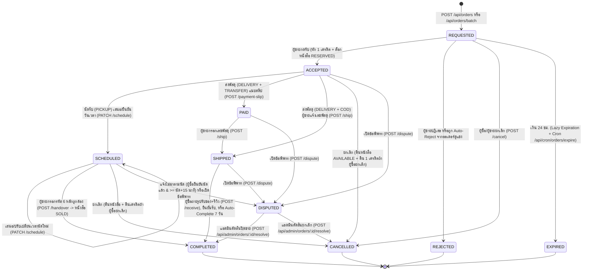
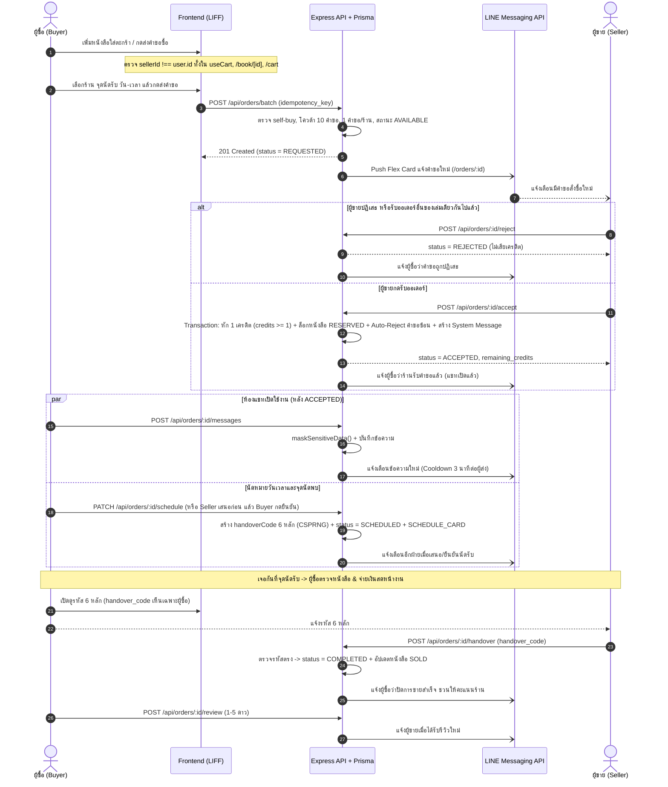
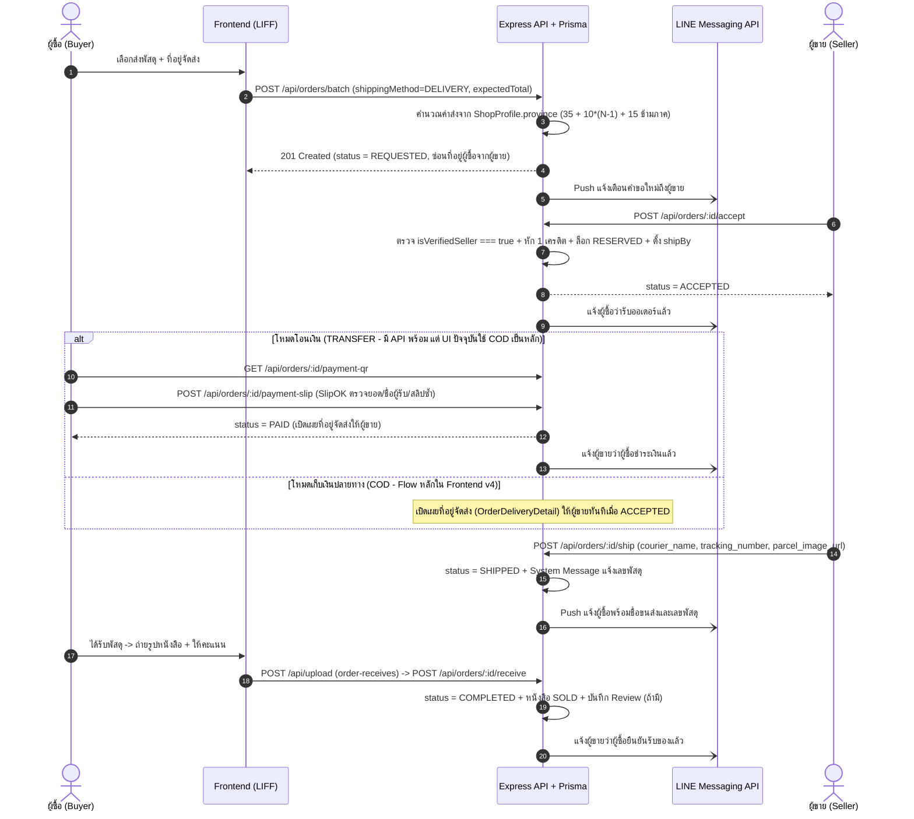

# GongDong — Buyer–Seller Order & Interaction Flow + Vulnerability Analysis

> **อัปเดตล่าสุด**: 2026-11-16  
> **ขอบเขต**: Flow การทำงานและการโต้ตอบระหว่าง **ผู้ซื้อ (Buyer)** – **ผู้ขาย (Seller)** – **ระบบ (Backend / DB / LINE Messaging API)** ตั้งแต่เลือกหนังสือใส่ตะกร้า ส่งคำขอซื้อ นัดรับ/ส่งพัสดุ แชท ปิดการขาย รีวิว ยกเลิก ข้อพิพาท รวมถึงการวิเคราะห์ช่องโหว่ (ทั้งที่แก้ไขแล้วและจุดที่ยังพบในโค้ดปัจจุบัน)

---

## 1. ภาพรวมและหลักการออกแบบ Flow

1. **1 Order = 1 Seller (Multi-Book, Multi-Seller Batch)**:
   - ตะกร้าสินค้า ([useCart.tsx](file:///D:/Project/GongDong-Hack-DII/frontend/src/hooks/useCart.tsx)) จัดกลุ่มหนังสือแยกตามร้านค้า (`sellerId`) และหน้า Checkout ([cart/page.tsx](file:///D:/Project/GongDong-Hack-DII/frontend/src/app/cart/page.tsx)) ส่ง `POST /api/orders/batch` สร้างออเดอร์หลายร้านพร้อมกันแบบ **All-or-Nothing** ใน Prisma `$transaction` เดียว ([orderService.ts](file:///D:/Project/GongDong-Hack-DII/backend/src/services/orderService.ts#L486-L615))
2. **ยังไม่ล็อกหนังสือตอนส่งคำขอ (`REQUESTED`)**:
   - เพื่อกันการกดกั๊กหนังสือฟรี หนังสือยังคงสถานะ `AVAILABLE` จนกว่าผู้ขายจะกดรับออเดอร์ (`acceptOrder`)
   - ผู้ซื้อ 1 คนมีคำขอ `REQUESTED` ค้างได้สูงสุด **10 ออเดอร์** และ **ไม่เกิน 1 คำขอค้างต่อ 1 ร้านค้า** ([orderService.ts](file:///D:/Project/GongDong-Hack-DII/backend/src/services/orderService.ts#L266-L279), [orderService.ts](file:///D:/Project/GongDong-Hack-DII/backend/src/services/orderService.ts#L566-L577))
3. **1 Credit-on-Accept & Selective KYC**:
   - การส่งคำขอซื้อและปฏิเสธคำขอ **ไม่เสียเครดิต**
   - ผู้ขายจะถูกหัก **1 เครดิต** แบบ Atomic เฉพาะตอนกดรับออเดอร์ (`acceptOrder`)
   - **นัดรับ (`PICKUP`)**: ไม่ต้องยืนยันตัวตน (KYC) — **ส่งพัสดุ (`DELIVERY`)**: บังคับ `isVerifiedSeller === true` ([orderService.ts](file:///D:/Project/GongDong-Hack-DII/backend/src/services/orderService.ts#L899-L906))
4. **PDPA & Anti-Leakage Shield**:
   - ช่วง `REQUESTED`: ซ่อนตัวตนผู้ซื้อเป็น `ผู้ซื้อ #<4 ตัวท้าย>`, ซ่อนที่อยู่/เบอร์โทร และ **ปิดห้องแชท** (`CHAT_NOT_OPEN`)
   - หลัง `ACCEPTED`: เปิดห้องแชทพร้อม Auto-Masking เบอร์โทร/LINE ID/อีเมล/ลิงก์ ([dataMaskingService.ts](file:///D:/Project/GongDong-Hack-DII/backend/src/services/dataMaskingService.ts), [messageService.ts](file:///D:/Project/GongDong-Hack-DII/backend/src/services/messageService.ts#L135-L147)) และเปิดเผยที่อยู่จัดส่งให้ผู้ขายเฉพาะโหมด `DELIVERY` เมื่อ `PAID` / `SHIPPED` หรือ `COD + ACCEPTED` ([orderService.ts](file:///D:/Project/GongDong-Hack-DII/backend/src/services/orderService.ts#L707-L728))

---

## 2. Order State Machine (อิงโค้ดจริง Frontend + Backend)

---

## 3. Sequence Diagram การโต้ตอบระหว่าง Buyer – Seller – System

### 3.1 เส้นทางที่ 1: สั่งซื้อแบบนัดรับ (`PICKUP` — เจอหน้า ตรวจของ จ่ายเงินสด กรอกรหัส 6 หลัก)

### 3.2 เส้นทางที่ 2: สั่งซื้อแบบส่งพัสดุ (`DELIVERY` — COD และ โอนเงิน/สลิป)

---

## 4. ตารางโต้ตอบ & กฎควบคุมแต่ละ Stage

| Stage / Status | ผู้ที่ต้องดำเนินการ (`whoActs`) | สิ่งที่โต้ตอบได้ (API / UI) | ผลต่อ DB, เครดิต, สต็อก & PDPA | LINE Push & In-App Notify |
|---|---|---|---|---|
| **Checkout** (`/cart`) | Buyer | เพิ่มหนังสือใน `useCart`, เลือกจุดนัดหรือที่อยู่จัดส่ง, กดส่งคำขอ `POST /api/orders` หรือ `/batch` | กัน `buyerId === sellerId` (`CANNOT_BUY_OWN_BOOK`), จำกัด 10 `REQUESTED`/คน และ 1 `REQUESTED`/ร้าน, คำนวณยอดบน Server (`PRICE_CHANGED` ถ้าไม่ตรง) | แจ้ง **Seller** (`NEW ORDER REQUEST` -> `/orders/:id`) |
| **`REQUESTED`** | Seller | Seller กดรับ (`/accept`) หรือปฏิเสธ (`/reject`) · Buyer กดยกเลิก (`/cancel`) | หนังสือยัง **`AVAILABLE`**, ห้องแชท **ปิด**, ตัวตนผู้ซื้อพรางเป็น `ผู้ซื้อ #XXXX`, ซ่อนที่อยู่จัดส่ง | รับ -> แจ้ง Buyer (และ Buyer คู่แข่งที่ถูก Auto-Reject) · ปฏิเสธ -> แจ้ง Buyer |
| **`ACCEPTED`** (`PICKUP`) | Both / Seller | เปิดแชท (`/messages`), เสนอ/ยืนยันเวลานัด (`/schedule`), เปิดข้อพิพาท (`/dispute`) | หัก **1 เครดิต** Seller, หนังสือเป็น **`RESERVED`**, แชทเปิดพร้อม `maskSensitiveData()`, ยังไม่เผยที่อยู่/เบอร์ส่วนตัว | ส่งข้อความแชทแจ้งเตือนอีกฝ่าย (Cooldown **3 นาที** ต่อคน/ออเดอร์) |
| **`ACCEPTED`** (`DELIVERY`) | Seller (COD) / Buyer (TRANSFER) | COD: Seller แจ้งเลขพัสดุ (`/ship`) · TRANSFER: Buyer ขอ QR (`/payment-qr`) + ส่งสลิป (`/payment-slip`) | COD เปิดเผยที่อยู่ผู้รับทันทีเมื่อ `ACCEPTED` · TRANSFER เปิดเผยเมื่อ `PAID`, ตรวจสลิปซ้ำ (`P2002` + SlipOK) | ชำระเงิน -> แจ้ง Seller · ส่งของ -> แจ้ง Buyer |
| **`SCHEDULED`** (`PICKUP`) | Buyer & Seller | ดู/แก้เวลานัด (`/schedule`), Seller กรอกรหัส 6 หลัก (`/handover`), Seller แจ้งไม่มาตามนัด (`/report-missed-meeting`) | `handoverCode` 6 หลักแสดงเฉพาะ Buyer (`getOrderDetail`), แชทเปิดปกติ | เสนอ/ยืนยันนัด -> แจ้งอีกฝ่าย · แจ้ง No-Show -> แจ้ง Buyer |
| **`SHIPPED`** (`DELIVERY`) | Buyer | ถ่ายรูปยืนยันรับของ + รีวิว (`/receive`) หรือกดยืนยันรับ (`/complete-delivery`), เปิดข้อพิพาท (`/dispute`) | รอ Buyer กดรับ (ไม่มี Auto-Complete ใน Backend) | แจ้ง Seller เมื่อ Buyer ยืนยันรับของ |
| **`DISPUTED`** | Admin (ตาม UI) | ส่งข้อความ/หลักฐานในแชทได้, Buyer โต้แย้ง No-Show (`/dispute-missed-meeting`) | หยุดเวลาชั่วคราว, หนังสือยังค้าง `RESERVED` | แจ้งอีกฝ่ายเมื่อเปิดข้อพิพาท / โต้แย้ง |
| **`COMPLETED`** | Buyer (Review) | Buyer ให้คะแนน (`/review`) หากยังไม่ได้รีวิวพร้อม `/receive` | หนังสือเป็น **`SOLD`**, ห้องแชทเป็น **Read-Only**, Seller เห็น `handoverCode` และรูปรีวิว | แจ้ง Seller เมื่อ Buyer ส่งรีวิว |
| **`CANCELLED` / `REJECTED` / `EXPIRED`** | None | อ่านย้อนหลังเท่านั้น (แชท Read-Only หรือปิด) | ถ้า `CANCELLED` หลัง `ACCEPTED`/`SCHEDULED`: คืนหนังสือ `AVAILABLE` และคืน **1 เครดิต** ให้ Seller เฉพาะกรณี `cancelledBy === 'BUYER'` | แจ้งอีกฝ่ายพร้อมเหตุผลยกเลิก |

---

## 5. สถานการณ์ที่ทำให้เกิดช่องโหว่ (Vulnerabilities & Edge Cases)

### 5.1 ช่องโหว่ใน Flow การสั่งซื้อที่แก้ไขแล้ว (ยืนยันจากโค้ดปัจจุบัน)

| หัวข้อ | สถานการณ์ปัญหาเดิม | การแก้ไขที่มีอยู่แล้วในโค้ด |
|---|---|---|
| **ซื้อ/ใส่ตะกร้าของตัวเอง (Self-Purchase)** | เดิมมี guard เฉพาะ Backend (`CANNOT_BUY_OWN_BOOK`) แต่ Frontend ปล่อยให้ใส่ตะกร้าและกดถึงหน้า Checkout ได้ | ปิดแล้วใน [useCart.tsx](file:///D:/Project/GongDong-Hack-DII/frontend/src/hooks/useCart.tsx#L155-L162), [book/[id]/page.tsx](file:///D:/Project/GongDong-Hack-DII/frontend/src/app/book/[id]/page.tsx#L157-L195), [cart/page.tsx](file:///D:/Project/GongDong-Hack-DII/frontend/src/app/cart/page.tsx#L131-L135), [BookCard.tsx](file:///D:/Project/GongDong-Hack-DII/frontend/src/components/ui/BookCard.tsx#L135-L139) + Unit test ใน [orderService.test.ts](file:///D:/Project/GongDong-Hack-DII/backend/src/services/__tests__/orderService.test.ts#L514-L598) |
| **ไฟล์รูปภาพค้างเมื่อถ่ายซ้ำ (Orphan Storage)** | เดิมอัปโหลดขึ้น Supabase ทันทีที่ถ่ายซ้ำทำให้เปลืองพื้นที่ | แก้ด้วย Defer Upload + Rollback + `DELETE /api/upload` + Reference-safe cleanup ใน [uploadService.ts](file:///D:/Project/GongDong-Hack-DII/backend/src/services/uploadService.ts#L316-L567) และ [CameraCapture.tsx](file:///D:/Project/GongDong-Hack-DII/frontend/src/components/v4/CameraCapture.tsx#L144-L157) |
| **Race Condition รับออเดอร์ซ้อน / เครดิตติดลบ / คืนเครดิตซ้ำ** | กดรับ/ยกเลิกพร้อมกันแล้วเครดิตติดลบ หรือคืนเครดิตเบิ้ล | ใช้ `updateMany` เงื่อนไข `credits >= 1`, `status: 'AVAILABLE'`, และ `updateOrderStatusAtomic` ([orderService.ts](file:///D:/Project/GongDong-Hack-DII/backend/src/services/orderService.ts#L166-L200), [orderService.ts](file:///D:/Project/GongDong-Hack-DII/backend/src/services/orderService.ts#L926-L988)) |
| **ใช้สลิปซ้ำ / ปลอมสลิป** | ยิง `slipImageUrl` เดิมซ้ำหรือข้าม SlipOK | บังคับ `SlipOK` ใน Production (`503` ถ้าไม่มีคีย์) และตรวจซ้ำทั้ง `transRef` + `slipImageUrl` (`P2002`) ใน [orderService.ts](file:///D:/Project/GongDong-Hack-DII/backend/src/services/orderService.ts#L1315-L1422) |
| **ตั้งนัดย้อนหลัง & แจ้ง No-Show ก่อนยืนยันนัด** | ผู้ขายตั้งเวลาในอดีตแล้วกดรายงานผู้ซื้อไม่มาตามนัดทันทีทั้งที่ผู้ซื้อยังไม่ยืนยัน | แก้แล้วใน [orderService.ts](file:///D:/Project/GongDong-Hack-DII/backend/src/services/orderService.ts#L50-L79): ห้ามตั้งเวลาในอดีต (`SCHEDULE_IN_THE_PAST`), validate lat/lng (`INVALID_COORDINATES`), และบังคับ `scheduleConfirmedByBuyer === true` (`SCHEDULE_NOT_CONFIRMED_BY_BUYER`) |
| **เคส `DISPUTED` ค้างปิดไม่ได้** | ไม่มี Endpoint แอดมินตัดสินปิดข้อพิพาท ทำให้หนังสือค้าง `RESERVED` | แก้แล้วใน [admin.ts](file:///D:/Project/GongDong-Hack-DII/backend/src/routes/admin.ts) (`POST /api/admin/orders/:id/resolve` ป้องกันด้วย `ADMIN_API_KEY`) และ `resolveDisputedOrder` ใน [orderService.ts](file:///D:/Project/GongDong-Hack-DII/backend/src/services/orderService.ts) |
| **Timer 24 ชม. / 7 วันไม่มีผลฝั่ง Backend** | `REQUESTED` เกิน 24 ชม. ค้างกินโควตา 10 คำขอ และ `SHIPPED` ไม่มี Auto-Complete | แก้แล้วด้วย Lazy Expiration (`createOrder`, `acceptOrder`, `getOrderDetail`, `getUserOrders`) + Cron `GET/POST /api/cron/orders/expire` ([cron.ts](file:///D:/Project/GongDong-Hack-DII/backend/src/routes/cron.ts) ป้องกันด้วย `CRON_SECRET`) |
| **Brute-force รหัส 6 หลัก & ขาดปุ่มยกเลิกช่วง `ACCEPTED`/`SCHEDULED`** | ยิง `/handover` ไม่จำกัด และ UI ไม่มีปุ่มยกเลิกหลังรับออเดอร์ | แก้แล้ว: ล็อก `/handover` 15 นาทีเมื่อผิดครบ 5 ครั้ง (`429 HANDOVER_RATE_LIMITED`) และเพิ่มปุ่ม + ConfirmSheet ยกเลิกออเดอร์ช่วง `ACCEPTED`/`SCHEDULED` ใน [orders/[id]/page.tsx](file:///D:/Project/GongDong-Hack-DII/frontend/src/app/orders/[id]/page.tsx) |

---

### 5.2 ช่องโหว่ / สถานการณ์ขอบระดับ P2 ที่ **ยังเหลืออยู่ในโค้ดปัจจุบัน**

> *(หัวข้อ P0/P1 ด้านบนได้รับการแก้ไขและเพิ่ม Unit Test เรียบร้อยแล้วเมื่อ 2026-11-16)*

#### 1. [MEDIUM] `shipOrder` ยังไม่ตรวจ URL scheme ของ `parcelImageUrl`
- **ตำแหน่งโค้ด**: [orderService.ts](file:///D:/Project/GongDong-Hack-DII/backend/src/services/orderService.ts) (`shipOrder`)
- **สถานการณ์จำลอง**: `shipOrder` บันทึก `input.parcelImageUrl` ลง DB โดยไม่ตรวจว่าเป็น `http:` / `https:` URL ที่ถูกต้อง
- **แนวทางแก้ไข**: ตรวจ URL scheme (`http:` / `https:` เท่านั้น) ให้คืน `400 Bad Request` ก่อนบันทึก

#### 2. [LOW] ความไม่สอดคล้องของ Flow โอนเงิน (`TRANSFER`) vs COD-only บน UI
- **ตำแหน่งโค้ด**: [orders/[id]/page.tsx](file:///D:/Project/GongDong-Hack-DII/frontend/src/app/orders/[id]/page.tsx#L336-L343), [orderService.ts](file:///D:/Project/GongDong-Hack-DII/backend/src/services/orderService.ts), [useV4Orders.tsx](file:///D:/Project/GongDong-Hack-DII/frontend/src/hooks/useV4Orders.tsx)
- **สถานการณ์จำลอง**: Backend มี API PromptPay QR (`GET /payment-qr`), ตรวจสลิป (`POST /payment-slip`) และสถานะ `PAID` ครบถ้วน แต่ฝั่ง Frontend `cart` และ `orders/[id]` ถูกปรับเป็น COD-only (ไม่ส่ง `paymentMethod` ทำให้ default เป็น `COD` และขึ้นข้อความ `"ระบบไม่มีการโอนเงินออนไลน์"`) หากมี Client ยิง `paymentMethod: 'TRANSFER'` ผ่าน API โดยตรง หน้าจอผู้ซื้อบนเว็บจะไม่มีปุ่มแนบสลิป
- **แนวทางแก้ไข**: ตัดสินใจให้ชัดเจนระหว่าง (ก) เพิ่ม UI แสดง QR + SlipUploader เมื่อ `order.paymentMethod === 'TRANSFER'` หรือ (ข) ล็อกหรือซ่อนโหมด `TRANSFER` ชั่วคราวจนกว่าจะเปิดใช้จริง

#### 3. [LOW] `no-show/page.tsx` คำนวณเวลาผิดพลาดเมื่อ `timeLabel` ไม่มีรูปแบบ `HH:MM`
- **ตำแหน่งโค้ด**: [no-show/page.tsx](file:///D:/Project/GongDong-Hack-DII/frontend/src/app/orders/[id]/no-show/page.tsx#L63-L85)
- **สถานการณ์จำลอง**: `checkCanReport()` พยายาม regex หา `HH:MM` จาก `order.schedule.timeLabel` (เช่น `"เย็น 16–20 น."` ไม่มี `:`) ทำให้ `timeMatch` เป็น `null` แล้ว fallback เป็น `canReport: true` (ปุ่มกดรายงานขึ้นให้กดได้ทันที แต่เมื่อกดจริง Backend `reportMissedMeeting` ยังกันไว้ด้วย `scheduledAt + 15 นาที` และ `scheduleConfirmedByBuyer === true`)
- **แนวทางแก้ไข**: คำนวณจาก `order.schedule.scheduledAtISO` (หรือ `scheduledAt` จริงจาก Backend) แทนการ parse string ภาษาไทยของ `timeLabel`

---

## 6. สรุปสิ่งที่ดำเนินการแล้ว vs งานถัดไป (P2)

- ✅ **P0/P1 (แก้ไข + Unit Tests ผ่านครบ 18 ไฟล์ / 214 เคส)**: `schedulePickupOrder` future + lat/lng validation, `reportMissedMeeting` confirmation guard, `POST /api/admin/orders/:id/resolve`, Lazy Expiration + `GET/POST /api/cron/orders/expire`, Rate-Limit `/handover` (5 ครั้ง/15 นาที), ปุ่มยกเลิกออเดอร์ช่วง `ACCEPTED`/`SCHEDULED` บน UI
- ⏳ **P2 (รอเก็บรายละเอียดเพิ่มเติม)**: Validate `parcelImageUrl` scheme ใน `shipOrder`, ตัดสินใจโหมด `TRANSFER` vs `COD`, และปรับ `no-show/page.tsx` ให้อิง `scheduledAt` จริง
