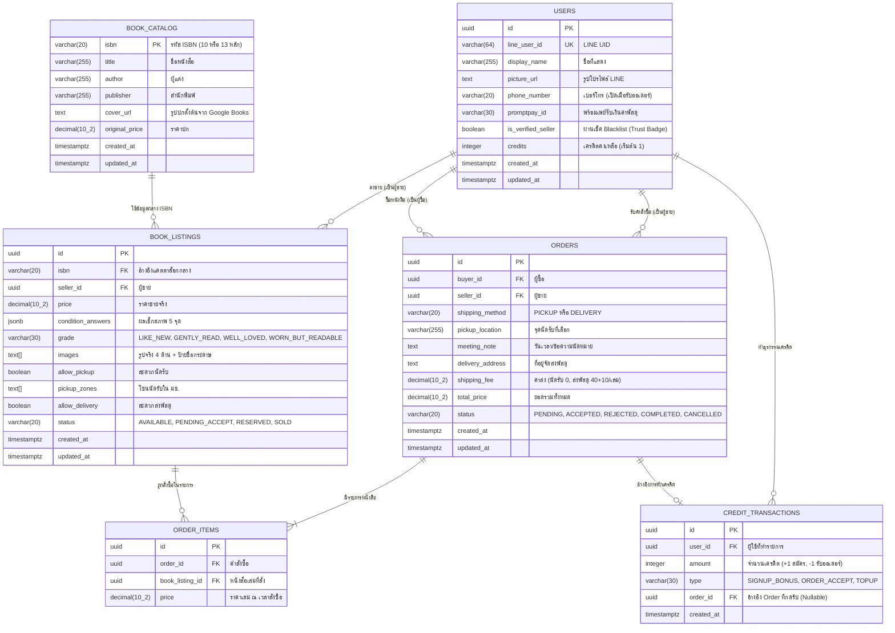

# GongDong (กองดอง) — Database Schema & ERD

> **ฐานข้อมูล:** PostgreSQL (Supabase)  
> **เวอร์ชัน:** 1.0.0 (MVP Hackathon 2569)  
> **อ้างอิงจาก:** `Backend-doc/GongDong-Pitch.pptx.pdf` และข้อตกลงใน `docs/API.md`

---

## 1. แผนภาพความสัมพันธ์ของข้อมูล (Entity Relationship Diagram - ERD)



---

## 2. คำอธิบายตารางและฟิลด์ (Data Dictionary)

### 2.1 ตาราง `users` (ข้อมูลผู้ใช้งาน)
เก็บบัญชีผู้ใช้ทั้งฝั่งผู้ซื้อและผู้ขายที่ Login ผ่าน LINE
- `id` (UUID, PK): รหัสเฉพาะของผู้ใช้ (`gen_random_uuid()`)
- `line_user_id` (VARCHAR(64), UNIQUE, NOT NULL): User ID จาก LINE Platform
- `display_name` (VARCHAR(255), NOT NULL): ชื่อที่แสดง
- `picture_url` (TEXT): URL รูปโปรไฟล์ LINE
- `phone_number` (VARCHAR(20), NULL): เบอร์ติดต่อ (ถูกซ่อนไว้จนกว่าผู้ขายจะกดรับออเดอร์)
- `promptpay_id` (VARCHAR(30), NULL): เลขพร้อมเพย์สำหรับรับเงินกรณีส่งพัสดุ
- `is_verified_seller` (BOOLEAN, DEFAULT FALSE): สถานะผ่านการตรวจ Blacklist (Trust Badge สไลด์หน้า 11)
- `credits` (INTEGER, DEFAULT 1, CHECK >= 0): เครดิตคงเหลือ (ผู้ใช้ใหม่ได้ฟรี 1 เครดิต)

### 2.2 ตาราง `book_catalog` (แคตตาล็อกหนังสือกลางจาก ISBN)
แยกออกมาเพื่อเป็นข้อมูล Master ตามแนวคิดของคุณบิว ทำให้เมื่อมีผู้ขายนำหนังสือที่มี ISBN เดิมมาลงขาย ระบบสามารถดึงชื่อเรื่อง ผู้แต่ง และราคาปกเดิมมาใช้ได้ทันทีโดยไม่ต้องยิง Google Books ซ้ำ
- `isbn` (VARCHAR(20), PK): รหัส ISBN
- `title` (VARCHAR(255), NOT NULL): ชื่อหนังสือ
- `author` (VARCHAR(255)): ผู้แต่ง
- `publisher` (VARCHAR(255)): สำนักพิมพ์
- `cover_url` (TEXT): รูปปกตั้งต้นจากฐานข้อมูลสากล
- `original_price` (DECIMAL(10, 2)): ราคาปกตั้งต้น (ใช้สำหรับคำนวณราคาแนะนำ 70%, 60%, 45%, 30%)

### 2.3 ตาราง `book_listings` (รายการหนังสือที่ผู้ขายลงขายจริง)
เก็บข้อมูลเล่มจริงของผู้ขายแต่ละคน แยกภาพถ่ายจริงและสภาพเฉพาะเล่ม
- `id` (UUID, PK): รหัสหนังสือที่ลงขาย
- `isbn` (VARCHAR(20), FK -> `book_catalog.isbn`): เชื่อมกับแคตตาล็อกกลาง
- `seller_id` (UUID, FK -> `users.id`): ผู้ขายที่เป็นเจ้าของ
- `price` (DECIMAL(10, 2), NOT NULL, CHECK > 0): ราคาขายจริงที่ผู้ขายตั้ง
- `condition_answers` (JSONB, NOT NULL): คำตอบเช็กสภาพ 5 จุด (`spine`, `stains`, `markings`, `covers`, `pages`)
- `grade` (VARCHAR(30), NOT NULL): เกรดอัตโนมัติที่ Server คำนวณ (`LIKE_NEW`, `GENTLY_READ`, `WELL_LOVED`, `WORN_BUT_READABLE`)
- `images` (TEXT[], NOT NULL): ลิงก์รูปภาพถ่ายจริงจาก Supabase Storage (รูปปกคู่ป้ายชื่อ, ปกหลัง, สันปก, สันกระดาษ, รูปตำหนิ)
- `allow_pickup` (BOOLEAN, DEFAULT TRUE): สะดวกให้นัดรับ
- `pickup_zones` (TEXT[], DEFAULT '{}'): โซนจุดนัดรับใน มช. ที่ผู้ขายสะดวก (เช่น `{"หน้าหอสมุดกลาง มช.", "ประตูหน้า มช."}`)
- `allow_delivery` (BOOLEAN, DEFAULT TRUE): สะดวกจัดส่งพัสดุ
- `status` (VARCHAR(20), DEFAULT 'AVAILABLE'): สถานะ (`AVAILABLE`, `PENDING_ACCEPT`, `RESERVED`, `SOLD`)

### 2.4 ตาราง `orders` (คำสั่งซื้อ)
บันทึกการส่งคำขอซื้อ การนัดรับ และการดีลระหว่างผู้ซื้อกับผู้ขาย
- `id` (UUID, PK): รหัสคำสั่งซื้อ
- `buyer_id` (UUID, FK -> `users.id`): ผู้ซื้อ
- `seller_id` (UUID, FK -> `users.id`): ผู้ขาย (บังคับ 1 ร้านค้าต่อ 1 ตะกร้า)
- `shipping_method` (VARCHAR(20), NOT NULL): วิธีรับสินค้า (`PICKUP`, `DELIVERY`)
- `pickup_location` (VARCHAR(255)): จุดนัดรับที่ผู้ซื้อเลือก
- `meeting_note` (TEXT): วันเวลาหรือข้อความเพิ่มเติมสำหรับนัดรับ
- `delivery_address` (TEXT): ที่อยู่จัดส่งกรณีเลือกส่งพัสดุ
- `shipping_fee` (DECIMAL(10, 2), DEFAULT 0.00): ค่าจัดส่ง (นัดรับ ฿0 / ส่งพัสดุ ฿40 เล่มแรก + ฿10 เล่มถัดไป)
- `total_price` (DECIMAL(10, 2), NOT NULL): ยอดรวมสุทธิ (ราคารวมหนังสือ + ค่าส่ง)
- `status` (VARCHAR(20), DEFAULT 'PENDING'): สถานะ (`PENDING`, `ACCEPTED`, `REJECTED`, `COMPLETED`, `CANCELLED`)

### 2.5 ตาราง `order_items` (รายการหนังสือในคำสั่งซื้อ)
รองรับการสั่งซื้อหนังสือหลายเล่มพร้อมกันจากผู้ขายคนเดียวกัน (สไลด์หน้า 7 ตะกร้ารวมร้านเดียวกัน)
- `id` (UUID, PK): รหัสรายการ
- `order_id` (UUID, FK -> `orders.id` ON DELETE CASCADE)
- `book_listing_id` (UUID, FK -> `book_listings.id` ON DELETE RESTRICT)
- `price` (DECIMAL(10, 2), NOT NULL): ราคาเล่มหนังสือ ณ จังหวะที่สั่งซื้อ (ป้องกันปัญหาราคาเปลี่ยนภายหลัง)

### 2.6 ตาราง `credit_transactions` (ประวัติการใช้งานเครดิต)
Audit Trail ตรวจสอบความโปร่งใสของเครดิตผู้ขาย
- `id` (UUID, PK): รหัสธุรกรรม
- `user_id` (UUID, FK -> `users.id` ON DELETE RESTRICT)
- `amount` (INTEGER, NOT NULL): จำนวนเครดิต (`+1` ตอนสมัครใหม่, `-1` ตอนกดรับคำสั่งซื้อ, `+3/+10/+25` เมื่อเติมเงิน)
- `type` (VARCHAR(30), NOT NULL): ประเภท (`SIGNUP_BONUS`, `ORDER_ACCEPT`, `TOPUP`)
- `order_id` (UUID, FK -> `orders.id` ON DELETE SET NULL): เลขออเดอร์ที่เกี่ยวข้อง (ถ้ามี)
- `created_at` (TIMESTAMPTZ, DEFAULT NOW())

---

## 3. ดัชนีและการเพิ่มประสิทธิภาพ (Indexing Strategy)

เพื่อรองรับการค้นหาที่รวดเร็วบน LIFF (หน้า B1 และ S4):
1. **`users(line_user_id)`** — UNIQUE B-tree Index ใช้ตอน Authentication ทุกครั้ง
2. **`book_listings(status, created_at DESC)`** — ใช้ดึงหน้าแรกแสดงหนังสือที่พร้อมขายล่าสุด
3. **`book_listings(seller_id)`** — Foreign Key Index ใช้ในหน้าร้านของฉัน (S4)
4. **`book_listings(isbn)`** — Foreign Key Index สำหรับเชื่อมโยงกับ Catalog
5. **`orders(buyer_id)` & `orders(seller_id, status)`** — ใช้ดึงรายการคำสั่งซื้อของฉันและการแจ้งเตือนออเดอร์เข้า
6. **`order_items(order_id)` & `order_items(book_listing_id)`** — Foreign Key Indexes สำหรับ JOIN ข้อมูล

---

## 4. สคริปต์ SQL DDL สำหรับรันบน PostgreSQL / Supabase

```sql
-- =============================================================================
-- GongDong (กองดอง) - Database Migration (UP)
-- =============================================================================

-- เปิดใช้งาน UUID Extension (สำหรับ Supabase/PostgreSQL)
CREATE EXTENSION IF NOT EXISTS "uuid-ossp";

-- 1. ตาราง USERS
CREATE TABLE IF NOT EXISTS users (
    id UUID PRIMARY KEY DEFAULT uuid_generate_v4(),
    line_user_id VARCHAR(64) UNIQUE NOT NULL,
    display_name VARCHAR(255) NOT NULL,
    picture_url TEXT,
    phone_number VARCHAR(20),
    promptpay_id VARCHAR(30),
    is_verified_seller BOOLEAN DEFAULT FALSE NOT NULL,
    credits INTEGER DEFAULT 1 NOT NULL CHECK (credits >= 0),
    created_at TIMESTAMPTZ DEFAULT CURRENT_TIMESTAMP NOT NULL,
    updated_at TIMESTAMPTZ DEFAULT CURRENT_TIMESTAMP NOT NULL
);

-- 2. ตาราง BOOK_CATALOG (Master Data จาก ISBN)
CREATE TABLE IF NOT EXISTS book_catalog (
    isbn VARCHAR(20) PRIMARY KEY,
    title VARCHAR(255) NOT NULL,
    author VARCHAR(255),
    publisher VARCHAR(255),
    cover_url TEXT,
    original_price DECIMAL(10, 2) CHECK (original_price >= 0),
    created_at TIMESTAMPTZ DEFAULT CURRENT_TIMESTAMP NOT NULL,
    updated_at TIMESTAMPTZ DEFAULT CURRENT_TIMESTAMP NOT NULL
);

-- 3. ตาราง BOOK_LISTINGS (รายการเล่มจริงของผู้ขาย)
CREATE TABLE IF NOT EXISTS book_listings (
    id UUID PRIMARY KEY DEFAULT uuid_generate_v4(),
    isbn VARCHAR(20) NOT NULL REFERENCES book_catalog(isbn) ON DELETE RESTRICT,
    seller_id UUID NOT NULL REFERENCES users(id) ON DELETE RESTRICT,
    price DECIMAL(10, 2) NOT NULL CHECK (price >= 0),
    condition_answers JSONB NOT NULL,
    grade VARCHAR(30) NOT NULL CHECK (grade IN ('LIKE_NEW', 'GENTLY_READ', 'WELL_LOVED', 'WORN_BUT_READABLE')),
    images TEXT[] NOT NULL,
    allow_pickup BOOLEAN DEFAULT TRUE NOT NULL,
    pickup_zones TEXT[] DEFAULT '{}' NOT NULL,
    allow_delivery BOOLEAN DEFAULT TRUE NOT NULL,
    status VARCHAR(20) DEFAULT 'AVAILABLE' NOT NULL CHECK (status IN ('AVAILABLE', 'PENDING_ACCEPT', 'RESERVED', 'SOLD')),
    created_at TIMESTAMPTZ DEFAULT CURRENT_TIMESTAMP NOT NULL,
    updated_at TIMESTAMPTZ DEFAULT CURRENT_TIMESTAMP NOT NULL
);

-- 4. ตาราง ORDERS (คำสั่งซื้อ)
CREATE TABLE IF NOT EXISTS orders (
    id UUID PRIMARY KEY DEFAULT uuid_generate_v4(),
    buyer_id UUID NOT NULL REFERENCES users(id) ON DELETE RESTRICT,
    seller_id UUID NOT NULL REFERENCES users(id) ON DELETE RESTRICT,
    shipping_method VARCHAR(20) NOT NULL CHECK (shipping_method IN ('PICKUP', 'DELIVERY')),
    pickup_location VARCHAR(255),
    meeting_note TEXT,
    delivery_address TEXT,
    shipping_fee DECIMAL(10, 2) DEFAULT 0.00 NOT NULL CHECK (shipping_fee >= 0),
    total_price DECIMAL(10, 2) NOT NULL CHECK (total_price >= 0),
    status VARCHAR(20) DEFAULT 'PENDING' NOT NULL CHECK (status IN ('PENDING', 'ACCEPTED', 'REJECTED', 'COMPLETED', 'CANCELLED')),
    created_at TIMESTAMPTZ DEFAULT CURRENT_TIMESTAMP NOT NULL,
    updated_at TIMESTAMPTZ DEFAULT CURRENT_TIMESTAMP NOT NULL,
    CONSTRAINT check_buyer_not_seller CHECK (buyer_id <> seller_id)
);

-- 5. ตาราง ORDER_ITEMS (รายการสินค้าในออเดอร์)
CREATE TABLE IF NOT EXISTS order_items (
    id UUID PRIMARY KEY DEFAULT uuid_generate_v4(),
    order_id UUID NOT NULL REFERENCES orders(id) ON DELETE CASCADE,
    book_listing_id UUID NOT NULL REFERENCES book_listings(id) ON DELETE RESTRICT,
    price DECIMAL(10, 2) NOT NULL CHECK (price >= 0)
);

-- 6. ตาราง CREDIT_TRANSACTIONS (ประวัติการใช้งานเครดิต)
CREATE TABLE IF NOT EXISTS credit_transactions (
    id UUID PRIMARY KEY DEFAULT uuid_generate_v4(),
    user_id UUID NOT NULL REFERENCES users(id) ON DELETE RESTRICT,
    amount INTEGER NOT NULL,
    type VARCHAR(30) NOT NULL CHECK (type IN ('SIGNUP_BONUS', 'ORDER_ACCEPT', 'TOPUP')),
    order_id UUID REFERENCES orders(id) ON DELETE SET NULL,
    created_at TIMESTAMPTZ DEFAULT CURRENT_TIMESTAMP NOT NULL
);

-- =============================================================================
-- INDEXES FOR PERFORMANCE
-- =============================================================================
CREATE INDEX IF NOT EXISTS idx_users_line_user_id ON users(line_user_id);
CREATE INDEX IF NOT EXISTS idx_book_listings_isbn ON book_listings(isbn);
CREATE INDEX IF NOT EXISTS idx_book_listings_seller_id ON book_listings(seller_id);
CREATE INDEX IF NOT EXISTS idx_book_listings_status_created ON book_listings(status, created_at DESC);
CREATE INDEX IF NOT EXISTS idx_orders_buyer_id ON orders(buyer_id);
CREATE INDEX IF NOT EXISTS idx_orders_seller_status ON orders(seller_id, status);
CREATE INDEX IF NOT EXISTS idx_order_items_order_id ON order_items(order_id);
CREATE INDEX IF NOT EXISTS idx_order_items_book_listing_id ON order_items(book_listing_id);
CREATE INDEX IF NOT EXISTS idx_credit_transactions_user_id ON credit_transactions(user_id);

-- =============================================================================
-- DOWN MIGRATION (ROLLBACK)
-- =============================================================================
/*
DROP TABLE IF EXISTS credit_transactions CASCADE;
DROP TABLE IF EXISTS order_items CASCADE;
DROP TABLE IF EXISTS orders CASCADE;
DROP TABLE IF EXISTS book_listings CASCADE;
DROP TABLE IF EXISTS book_catalog CASCADE;
DROP TABLE IF EXISTS users CASCADE;
*/
```
