# GongDong (กองดอง) — Database Schema & ERD

> **ฐานข้อมูล:** PostgreSQL (Supabase)  
> **เวอร์ชัน:** 3.0.0 (อัปเกรดเต็มรูปแบบให้รองรับ Frontend v4: Dual Payment `COD` & `TRANSFER`, Shop Profiles & Meetup Pins, PDPA Addresses, Set Books & `INNER` Image, In-Order Chat, Notifications และ Review Tags)  
> **อัปเดตล่าสุด:** 14 พ.ย. 2569  
> **อ้างอิงจาก:** [Backend-doc/กองดอง · User Flow v4 (ผู้ขาย + ผู้ซื้อ).md](../Backend-doc/กองดอง%20·%20User%20Flow%20v4%20(ผู้ขาย%20+%20ผู้ซื้อ).md), [frontend/docs/GongDong-Current-Flow-TH.md](../frontend/docs/GongDong-Current-Flow-TH.md) และ [Backend-doc/TECH_STACK.md](../Backend-doc/TECH_STACK.md)

---

## 1. แผนภาพความสัมพันธ์ของข้อมูล (Entity Relationship Diagram - ERD)

```mermaid
erDiagram
    USERS ||--o| SHOP_PROFILES : "เป็นเจ้าของร้าน (user_id)"
    SHOP_PROFILES ||--o{ SHOP_MEETUP_POINTS : "มีหมุดนัดรับ (1:N)"
    USERS ||--o{ USER_ADDRESSES : "บันทึกที่อยู่จัดส่ง (1:N)"
    USERS ||--o{ BOOK_LISTINGS : "ลงขาย (seller_id)"
    USERS ||--o{ ORDERS : "ซื้อหนังสือ (buyer_id)"
    USERS ||--o{ ORDERS : "รับคำสั่งซื้อ (seller_id)"
    USERS ||--o{ ORDER_MESSAGES : "ส่งข้อความแชท (sender_id)"
    USERS ||--o{ PAYMENT_SLIPS : "อัปโหลดสลิป (user_id)"
    USERS ||--o{ CREDIT_TRANSACTIONS : "ทำธุรกรรมเครดิต (user_id)"
    USERS ||--o{ REVIEWS : "ผู้เขียนรีวิว (reviewer_id)"
    USERS ||--o{ REVIEWS : "ผู้ถูกรีวิว (reviewee_id)"
    USERS ||--o{ NOTIFICATIONS : "รับแจ้งเตือน (user_id)"

    BOOK_CATALOG ||--o{ BOOK_LISTINGS : "อ้างอิงข้อมูลกลาง ISBN"
    BOOK_LISTINGS ||--|{ BOOK_LISTING_IMAGES : "มีรูปถ่ายสภาพจริง (1:N)"

    ORDERS ||--|{ ORDER_ITEMS : "มีรายการหนังสือ (1:N)"
    BOOK_LISTINGS ||--o{ ORDER_ITEMS : "ถูกสั่งซื้อในรายการ"
    ORDERS ||--o| ORDER_DELIVERY_DETAILS : "ข้อมูลจัดส่งพัสดุ (1:1 เฉพาะ DELIVERY)"
    ORDERS ||--o{ ORDER_MESSAGES : "แชทในออเดอร์ (1:N)"
    ORDERS ||--o{ PAYMENT_SLIPS : "สลิปค่าหนังสือ (1:N เฉพาะ TRANSFER)"
    ORDERS ||--o{ REVIEWS : "รีวิวประเมินผลคำสั่งซื้อ"
    ORDERS ||--o{ CREDIT_TRANSACTIONS : "อ้างอิงการหัก/คืนเครดิต"

    USERS {
        uuid id PK
        varchar(64) line_user_id UK "LINE UID สำหรับ Auth"
        varchar(255) display_name "ชื่อโปรไฟล์ LINE"
        text picture_url "รูปโปรไฟล์ LINE"
        varchar(100) nickname "ชื่อเล่นในกองดอง (แสดงสาธารณะ)"
        text avatar_url "รูปตัวแทนในกองดอง"
        varchar(20) phone_number "เบอร์โทร (Optional ตาม PDPA v4)"
        varchar(255) verified_name "ชื่อยืนยันจากสลิป/KYC"
        varchar(30) promptpay_id "พร้อมเพย์รับเงิน (เฉพาะโหมด TRANSFER)"
        boolean is_verified_seller "ผ่าน KYC แล้ว (ปลดล็อกส่งพัสดุ)"
        varchar(100) kyc_first_name "ชื่อจริง KYC (Admin เท่านั้น)"
        varchar(100) kyc_last_name "นามสกุล KYC (Admin เท่านั้น)"
        varchar(25) kyc_national_id_masked "เลขบัตร ปชช. แบบ Masked"
        varchar(64) kyc_national_id_hash UK "HMAC-SHA256 เลขบัตร ปชช. กันซ้ำข้ามบัญชี"
        timestamptz kyc_verified_at "เวลาที่ยืนยัน KYC สำเร็จ"
        timestamptz pdpa_consent_at "เวลาที่กดยินยอม PDPA"
        boolean is_blacklisted "สถานะถูกระงับ/แบน"
        integer no_show_count "จำนวนครั้งที่เทนัด"
        integer credits "เครดิตคงเหลือ (เริ่มต้น 1)"
        timestamptz created_at
        timestamptz updated_at
    }

    SHOP_PROFILES {
        uuid id PK
        uuid user_id UK "อ้างอิงผู้ใช้ 1:1"
        varchar(120) shop_name "ชื่อร้านค้าสาธารณะ"
        text description "คำอธิบายร้านค้า"
        text avatar_url "โลโก้/รูปโปรไฟล์ร้าน"
        varchar(100) province "จังหวัดต้นทาง (คำนวณค่าส่งข้ามภาค)"
        text_array available_days "วันที่สะดวกนัดรับ/ส่ง"
        text_array available_slots "ช่วงเวลาที่สะดวก"
        boolean supports_parcel "เปิดรับส่งพัสดุหรือไม่"
        varchar(20) ship_mode "DAILY หรือ AFTER_ACCEPT"
        smallint ship_within_days "ส่งภายในกี่วันหลังรับออเดอร์"
        boolean setup_complete "ตั้งค่าร้านครบแล้ว"
        timestamptz created_at
        timestamptz updated_at
    }

    SHOP_MEETUP_POINTS {
        uuid id PK
        uuid shop_profile_id FK "อ้างอิงร้านค้า"
        varchar(255) name "ชื่อจุดนัดรับ"
        varchar(100) province "จังหวัดของจุดนัดรับ"
        decimal(10_7) lat "ละติจูด"
        decimal(10_7) lng "ลองจิจูด"
        text note "หมายเหตุจุดนัด"
        timestamptz created_at
    }

    USER_ADDRESSES {
        uuid id PK
        uuid user_id FK "เจ้าของที่อยู่"
        varchar(255) full_name "ชื่อผู้รับ (ไม่มีเบอร์โทรตาม PDPA v4)"
        varchar(100) province "จังหวัด"
        varchar(100) district "เขต/อำเภอ"
        varchar(100) subdistrict "แขวง/ตำบล"
        varchar(10) postal_code "รหัสไปรษณีย์"
        text detail "รายละเอียดบ้านเลขที่/ซอย/ถนน"
        boolean is_default "ที่อยู่หลัก"
        timestamptz created_at
        timestamptz updated_at
    }

    BOOK_CATALOG {
        varchar(20) isbn PK "รหัส ISBN 10 หรือ 13 หลัก"
        varchar(255) title "ชื่อหนังสือ"
        varchar(255) author "ผู้แต่ง"
        varchar(255) publisher "สำนักพิมพ์"
        varchar(100) category "หมวดหมู่หลักจาก Google Books"
        text cover_url "รูปปกตั้งต้น"
        decimal(10_2) original_price "ราคาปกตั้งต้น"
        timestamptz created_at
        timestamptz updated_at
    }

    BOOK_LISTINGS {
        uuid id PK
        varchar(20) isbn FK "อ้างอิงแคตตาล็อกกลาง"
        uuid seller_id FK "ผู้ขาย"
        boolean is_set "ขายยกชุดหรือไม่"
        smallint total_volumes "จำนวนเล่มทั้งหมดในชุด"
        int_array missing_volumes "เลขเล่มที่ขาด"
        text description "รายละเอียดเพิ่มเติม"
        decimal(10_2) price "ราคาขายจริง"
        jsonb condition_answers "คำตอบเช็กสภาพ 5 จุด"
        jsonb photo_checks "ผลตรวจสภาพแยกรายรูป"
        jsonb defects "รายการจุดตำหนิและรูปประกอบ"
        varchar(30) grade "LIKE_NEW, GENTLY_READ, WELL_LOVED, WORN_BUT_READABLE"
        varchar(100) category "หมวดหมู่หลัก"
        text_array categories "หมวดหมู่แบบเลือกได้หลายหมวด"
        boolean allow_pickup "สะดวกนัดรับ"
        decimal(10_7) pickup_lat "พิกัดละติจูดจุดนัดรับ"
        decimal(10_7) pickup_lng "พิกัดลองจิจูดจุดนัดรับ"
        varchar(255) pickup_location_name "ชื่อจุดนัดรับ"
        boolean allow_delivery "สะดวกส่งพัสดุ"
        boolean cod_enabled "รองรับเก็บเงินปลายทาง COD"
        varchar(20) status "AVAILABLE, RESERVED, HIDDEN, SOLD"
        timestamptz created_at
        timestamptz updated_at
    }

    BOOK_LISTING_IMAGES {
        uuid id PK
        uuid book_listing_id FK "อ้างอิงรายการลงขาย"
        text image_url "URL รูปถ่าย"
        varchar(30) image_type "FRONT_COVER, BACK_COVER, SPINE, INNER, EDGE, DEFECT"
        smallint display_order "ลำดับการแสดงผล"
        boolean is_cover "เป็นรูปหน้าปกหลัก"
        timestamptz created_at
    }

    ORDERS {
        uuid id PK
        uuid buyer_id FK "ผู้ซื้อ"
        uuid seller_id FK "ผู้ขาย"
        varchar(20) shipping_method "PICKUP หรือ DELIVERY"
        varchar(20) payment_method "COD หรือ TRANSFER"
        decimal(10_7) pickup_lat "พิกัดจุดนัดรับ"
        decimal(10_7) pickup_lng "พิกัดจุดนัดรับ"
        varchar(255) pickup_location_name "ชื่อจุดนัดรับ"
        timestamptz scheduled_at "วันเวลานัดพบ"
        varchar(20) schedule_date_iso "วันที่นัดแบบ ISO (YYYY-MM-DD)"
        varchar(60) schedule_time_label "ช่วงเวลานัด (เช่น เย็น 16-20 น.)"
        varchar(20) schedule_proposed_by "BUYER หรือ SELLER"
        boolean schedule_confirmed_by_buyer "ผู้ซื้อยืนยันนัดแล้ว"
        varchar(6) handover_code "รหัสส่งมอบ 6 หลัก (โหมด TRANSFER)"
        text received_photo_url "รูปถ่ายยืนยันรับของจากผู้ซื้อ"
        timestamptz received_at "เวลาที่ผู้ซื้อยืนยันรับของ"
        timestamptz missed_meeting_reported_at "เวลาที่แจ้งไม่มาตามนัด"
        smallint ship_within_days "กำหนดวันจัดส่ง"
        timestamptz ship_by "เส้นตายการจัดส่ง"
        decimal(10_2) shipping_fee "ค่าส่ง (35+10/เล่ม +15 ข้ามภาค)"
        decimal(10_2) total_price "ยอดรวมสุทธิ"
        varchar(20) status "REQUESTED..COMPLETED/DISPUTED"
        text cancel_reason "เหตุผลการยกเลิก"
        varchar(20) cancelled_by "BUYER หรือ SELLER"
        uuid disputed_by FK "ผู้เปิดข้อพิพาท"
        varchar(20) dispute_opened_by "BUYER หรือ SELLER"
        text dispute_reason "เหตุผลการแจ้งปัญหา"
        timestamptz disputed_at "เวลาแจ้งปัญหา"
        varchar(128) idempotency_key UK "คีย์กันสั่งซื้อซ้ำระดับ DB"
        timestamptz created_at
        timestamptz updated_at
    }

    ORDER_DELIVERY_DETAILS {
        uuid id PK
        uuid order_id UK "อ้างอิงออเดอร์ (1:1)"
        varchar(255) recipient_name "ชื่อผู้รับหน้ากล่อง"
        varchar(20) recipient_phone "เบอร์โทร (Nullable ตาม PDPA v4)"
        varchar(100) province "จังหวัดผู้รับ (คำนวณค่าส่งข้ามภาค)"
        text delivery_address "ที่อยู่จัดส่งเต็ม"
        varchar(50) courier_name "ชื่อบริษัทขนส่ง"
        varchar(100) tracking_number "เลขพัสดุ"
        text parcel_image_url "รูปถ่ายกล่องพัสดุ"
        timestamptz shipped_at "เวลาที่จัดส่ง"
        timestamptz created_at
        timestamptz updated_at
    }

    ORDER_ITEMS {
        uuid id PK
        uuid order_id FK "คำสั่งซื้อ"
        uuid book_listing_id FK "หนังสือเล่มที่สั่ง"
        decimal(10_2) price "ราคา ณ เวลาสั่งซื้อ"
    }

    ORDER_MESSAGES {
        uuid id PK
        uuid order_id FK "คำสั่งซื้อ"
        uuid sender_id FK "ผู้ส่ง (Nullable สำหรับ SYSTEM)"
        varchar(20) sender_role "BUYER, SELLER, SYSTEM"
        varchar(20) kind "TEXT, SYSTEM, SCHEDULE_CARD"
        text text "ข้อความที่ผ่าน Data Masking แล้ว"
        boolean is_masked "ถูกซ่อนข้อมูลติดต่อหรือไม่"
        timestamptz created_at
    }

    PAYMENT_SLIPS {
        uuid id PK
        uuid user_id FK "ผู้โอนเงิน / เจ้าของสลิป"
        uuid order_id FK "อ้างอิงออเดอร์ (Nullable)"
        varchar(30) slip_type "ORDER_PAYMENT หรือ CREDIT_TOPUP"
        text slip_image_url "ลิงก์รูปสลิปใน Private Bucket"
        text storage_path "path ไฟล์ใน Private Bucket สำหรับ re-sign URL"
        varchar(100) trans_ref UK "เลขอ้างอิงสลิป ธปท."
        decimal(10_2) amount "ยอดเงินในสลิป"
        varchar(255) receiver_name "ชื่อผู้รับเงิน"
        varchar(30) verification_status "AUTO_VERIFIED, PENDING_ADMIN, REJECTED"
        text rejection_reason "สาเหตุที่ปฏิเสธ"
        timestamptz verified_at "เวลาที่ตรวจผ่าน"
        timestamptz created_at
    }

    REVIEWS {
        uuid id PK
        uuid order_id FK "คำสั่งซื้อที่เสร็จสิ้น"
        uuid reviewer_id FK "ผู้ให้คะแนน"
        uuid reviewee_id FK "ผู้ถูกประเมิน"
        smallint rating "คะแนน 1-5 ดาว"
        boolean is_condition_accurate "สภาพตรงเกรดหรือไม่"
        text_array tags "แท็กจุดเด่น (เช่น ตรงปก, แพ็กดี)"
        text comment "ความคิดเห็นเพิ่มเติม"
        timestamptz created_at
    }

    CREDIT_TRANSACTIONS {
        uuid id PK
        uuid user_id FK "ผู้ใช้ที่ทำรายการ"
        integer amount "จำนวนเครดิต (+ / -)"
        integer balance_after "ยอดเครดิตคงเหลือหลังทำรายการ"
        varchar(30) type "SIGNUP_BONUS, ORDER_ACCEPT, TOPUP, REFUND_NO_SHOW"
        uuid order_id FK "อ้างอิง Order ที่เกี่ยวข้อง"
        text note "คำอธิบายรายการ"
        timestamptz created_at
    }

    NOTIFICATIONS {
        uuid id PK
        uuid user_id FK "ผู้รับแจ้งเตือน"
        varchar(20) role "BUYER หรือ SELLER"
        varchar(30) type "ORDER, WISHLIST, SYSTEM, CREDIT"
        varchar(255) title "หัวข้อแจ้งเตือน"
        text message "ข้อความแจ้งเตือน"
        text link_url "Deep Link ปลายทางในแอป"
        boolean is_read "อ่านแล้วหรือยัง"
        timestamptz created_at
    }
```



---

## 2. คำอธิบายตารางและพจนานุกรมข้อมูล (Data Dictionary — v3.0.0)

### 2.1 ตาราง `users` (ข้อมูลผู้ใช้งาน & KYC)
เก็บบัญชีผู้ใช้ทั้งผู้ซื้อและผู้ขาย พร้อมรองรับ **KYC บัตรประชาชนแบบ Masked**, นับสถิติไม่มาตามนัด และระบบ PDPA:
* `id` (UUID, PK): รหัสผู้ใช้งาน (`uuid_generate_v4()`)
* `line_user_id` (VARCHAR(64), UNIQUE, NOT NULL): LINE User ID ที่ได้จาก LINE Login (LIFF)
* `display_name` (VARCHAR(255), NOT NULL): ชื่อบัญชี LINE ดั้งเดิม
* `picture_url` (TEXT): รูปโปรไฟล์ LINE ดั้งเดิม
* `nickname` (VARCHAR(100)): **ชื่อเล่นในกองดอง** (แสดงสาธารณะแทนชื่อ LINE)
* `avatar_url` (TEXT): **รูปตัวแทนในกองดอง**
* `phone_number` (VARCHAR(20)): เบอร์โทรศัพท์ (Optional ตามกฎ PDPA v4 ไม่บังคับกรอกตอนสมัคร/สั่งซื้อ)
* `verified_name` (VARCHAR(255)): ชื่อยืนยันจากสลิปหรือ KYC
* `promptpay_id` (VARCHAR(30)): พร้อมเพย์รับเงินของผู้ขาย (ใช้เฉพาะโหมด `TRANSFER`)
* `is_verified_seller` (BOOLEAN, DEFAULT FALSE): ผ่าน KYC แล้วหรือไม่ (ร้านที่ยังไม่ Verified ยังคงลงขายและรับออเดอร์แบบ **นัดรับ (`PICKUP`)** ได้ โดยระบบจะล็อกเฉพาะการจัดส่ง **พัสดุ (`DELIVERY`)**)
* `kyc_first_name` / `kyc_last_name` (VARCHAR(100)): ชื่อจริง-นามสกุลจริงจากหน้า `/seller/setup` (**Admin เท่านั้น ห้ามส่งใน Public API**)
* `kyc_national_id_masked` (VARCHAR(25)): เลขบัตรประชาชน 13 หลักแบบ Masked เช่น `x-xxxx-xxxxx-12-3` (ห้ามเก็บเลขดิบ)
* `kyc_national_id_hash` (VARCHAR(64), UNIQUE, Nullable): HMAC-SHA256 hash ของเลขบัตรประชาชน 13 หลัก สำหรับกันยืนยัน KYC ซ้ำข้ามบัญชีโดยไม่เก็บเลขบัตรจริง
* `kyc_verified_at` (TIMESTAMPTZ): วันเวลาที่ผ่านการตรวจ KYC
* `pdpa_consent_at` (TIMESTAMPTZ, Nullable): วันเวลาที่ผู้ใช้กดยืนยอม PDPA ล่าสุด
* `is_blacklisted` (BOOLEAN, DEFAULT FALSE): สถานะถูกแบน
* `no_show_count` (INTEGER, DEFAULT 0): จำนวนครั้งที่ไม่มาตามนัด (แสดงฝั่งผู้ขายเพื่อประกอบการตัดสินใจ)
* `credits` (INTEGER, DEFAULT 1, CHECK >= 0): เครดิตคงเหลือ
* `created_at` / `updated_at` (TIMESTAMPTZ)

---

### 2.2 ตาราง `shop_profiles` (ข้อมูลร้านค้าสาธารณะ & ตารางจัดส่ง) ✨ *ใหม่*
แยกข้อมูลร้านค้าออกจาก `users` แบบ 1:1 เพื่อให้สอดคล้องกับระบบสลับโหมด Buyer/Seller (`/seller/setup`):
* `id` (UUID, PK): รหัสร้านค้า
* `user_id` (UUID, UNIQUE, FK -> `users.id` ON DELETE CASCADE): เจ้าของร้าน
* `shop_name` (VARCHAR(120), NOT NULL): ชื่อร้านค้าสาธารณะ (ห้ามแสดงชื่อจริง LINE หรือเบอร์โทร)
* `description` (TEXT): คำอธิบายร้านค้า
* `avatar_url` (TEXT): โลโก้ร้านค้า
* `province` (VARCHAR(100), DEFAULT 'เชียงใหม่'): จังหวัดต้นทางสำหรับคำนวณค่าส่งพัสดุข้ามภาค
* `available_days` (TEXT[], DEFAULT '{}'): วันที่สะดวกรับ/ส่ง เช่น `['จ', 'อ', 'พ']`
* `available_slots` (TEXT[], DEFAULT '{}'): ช่วงเวลา เช่น `['เช้า 9–12 น.', 'บ่าย 12–16 น.']`
* `supports_parcel` (BOOLEAN, DEFAULT FALSE): เปิดรับจัดส่งพัสดุหรือไม่
* `ship_mode` (VARCHAR(20), DEFAULT 'AFTER_ACCEPT'): โหมดจัดส่ง (`DAILY` | `AFTER_ACCEPT`)
* `ship_within_days` (SMALLINT, DEFAULT 2): จัดส่งภายใน N วันหลังรับออเดอร์
* `setup_complete` (BOOLEAN, DEFAULT FALSE): ตั้งค่าร้านครบขั้นตอนแล้ว
* `created_at` / `updated_at` (TIMESTAMPTZ)

---

### 2.3 ตาราง `shop_meetup_points` (หมุดจุดนัดรับของร้าน) ✨ *ใหม่*
รองรับการปักหมุดจุดนัดรับหลายจุดบนแผนที่ OpenStreetMap / Leaflet:
* `id` (UUID, PK): รหัสจุดนัดรับ
* `shop_profile_id` (UUID, FK -> `shop_profiles.id` ON DELETE CASCADE): อ้างอิงร้านค้า
* `name` (VARCHAR(255), NOT NULL): ชื่อสถานที่/จุดสังเกต
* `province` (VARCHAR(100), NOT NULL): จังหวัด
* `lat` / `lng` (DECIMAL(10, 7), NOT NULL): พิกัด GPS
* `note` (TEXT): หมายเหตุเพิ่มเติม
* `created_at` (TIMESTAMPTZ)

---

### 2.4 ตาราง `user_addresses` (ที่อยู่จัดส่งของผู้ซื้อ) ✨ *ใหม่*
รองรับการจัดการหลายที่อยู่ (`/addresses`) โดย **ไม่เก็บเบอร์โทรศัพท์** ตามกฎ PDPA v4:
* `id` (UUID, PK): รหัสที่อยู่
* `user_id` (UUID, FK -> `users.id` ON DELETE CASCADE): เจ้าของที่อยู่
* `full_name` (VARCHAR(255), NOT NULL): ชื่อ-นามสกุลผู้รับหน้ากล่อง
* `province` (VARCHAR(100), NOT NULL): จังหวัด (ใช้คำนวณค่าส่งข้ามภาค)
* `district` (VARCHAR(100), NOT NULL): เขต/อำเภอ
* `subdistrict` (VARCHAR(100), NOT NULL): แขวง/ตำบล
* `postal_code` (VARCHAR(10), NOT NULL): รหัสไปรษณีย์
* `detail` (TEXT, NOT NULL): รายละเอียดที่อยู่ (บ้านเลขที่, ซอย, ถนน)
* `is_default` (BOOLEAN, DEFAULT FALSE): ใช้เป็นที่อยู่เริ่มต้นหรือไม่
* `created_at` / `updated_at` (TIMESTAMPTZ)

---

### 2.5 ตาราง `book_catalog` (แคตตาล็อกหนังสือสากลจาก ISBN)
เก็บข้อมูล Master Data กลางจาก Google Books API:
* `isbn` (VARCHAR(20), PK): รหัส ISBN 10 หรือ 13 หลัก
* `title` (VARCHAR(255), NOT NULL): ชื่อหนังสือ
* `author` (VARCHAR(255)): ชื่อผู้แต่ง
* `publisher` (VARCHAR(255)): สำนักพิมพ์
* `category` (VARCHAR(100)): หมวดหมู่สากล
* `cover_url` (TEXT): ลิงก์รูปปกมาตรฐาน
* `original_price` (DECIMAL(10, 2)): ราคาปกตั้งต้น
* `created_at` / `updated_at` (TIMESTAMPTZ)

---

### 2.6 ตาราง `book_listings` (รายการหนังสือที่ผู้ขายลงขายจริง — รองรับเล่มเดียว & ยกชุด)
* `id` (UUID, PK): รหัสรายการลงขาย
* `isbn` (VARCHAR(20), FK -> `book_catalog.isbn`): อ้างอิงแคตตาล็อกกลาง
* `seller_id` (UUID, FK -> `users.id`): รหัสผู้ขาย
* `is_set` (BOOLEAN, DEFAULT FALSE): ขายยกชุดหรือไม่ (`SINGLE` vs `SET`)
* `total_volumes` (SMALLINT): จำนวนเล่มทั้งหมดในชุด (เฉพาะกรณี `is_set = true`)
* `missing_volumes` (INTEGER[], DEFAULT '{}'): เลขเล่มที่ขาดในชุด
* `description` (TEXT): คำอธิบายเพิ่มเติม (สูงสุด 500 ตัวอักษร)
* `price` (DECIMAL(10, 2), NOT NULL, CHECK >= 0): ราคาขายจริง
* `condition_answers` (JSONB, NOT NULL): ผลตรวจสภาพ 5 จุด
* `photo_checks` (JSONB): ผลเช็กสภาพแยกรายภาพจากขั้น `/seller/list/step-3`
* `defects` (JSONB): อาเรย์ของจุดตำหนิ `[{ id, note, photo }]`
* `grade` (VARCHAR(30), NOT NULL): `LIKE_NEW`, `GENTLY_READ`, `WELL_LOVED`, `WORN_BUT_READABLE`
* `category` (VARCHAR(100), DEFAULT 'ทั่วไป / ไลฟ์สไตล์'): หมวดหมู่หลัก (Backward Compatible)
* `categories` (TEXT[], DEFAULT '{}'): รายการหมวดหมู่หลายตัวที่ผู้ขายเลือกได้
* `allow_pickup` / `allow_delivery` (BOOLEAN, DEFAULT TRUE): วิธีส่งมอบที่รองรับ
* `cod_enabled` (BOOLEAN, DEFAULT TRUE): รองรับเก็บเงินปลายทาง (COD)
* `pickup_lat` / `pickup_lng` (DECIMAL(10, 7)) & `pickup_location_name` (VARCHAR(255))
* `status` (VARCHAR(20), DEFAULT 'AVAILABLE'): `AVAILABLE`, `RESERVED`, **`HIDDEN`**, `SOLD`
* `created_at` / `updated_at` (TIMESTAMPTZ)

---

### 2.7 ตาราง `book_listing_images` (รูปถ่ายจริงของหนังสือ)
* `id` (UUID, PK)
* `book_listing_id` (UUID, FK -> `book_listings.id` ON DELETE CASCADE)
* `image_url` (TEXT, NOT NULL): URL รูปภาพใน Supabase Storage (`book-listings/`)
* `image_type` (VARCHAR(30), NOT NULL): `FRONT_COVER`, `BACK_COVER`, `SPINE`, **`INNER`** (หน้าด้านใน — มาตรฐานใหม่), `EDGE` (รองรับเดิม), `DEFECT`
* `display_order` (SMALLINT, DEFAULT 1)
* `is_cover` (BOOLEAN, DEFAULT FALSE)
* `created_at` (TIMESTAMPTZ)

---

### 2.8 ตาราง `orders` (คำสั่งซื้อหลัก — Dual Mode `COD` & `TRANSFER`)
* `id` (UUID, PK)
* `buyer_id` / `seller_id` (UUID, FK -> `users.id`)
* `shipping_method` (VARCHAR(20), NOT NULL): `PICKUP` | `DELIVERY`
* `payment_method` (VARCHAR(20), DEFAULT 'COD', NOT NULL): **`COD`** (เก็บเงินปลายทาง/เงินสดตาม Frontend v4) หรือ **`TRANSFER`** (โอนสลิป + รหัส 6 หลัก)
* **ฟิลด์นัดรับ (`PICKUP`):** `pickup_lat`, `pickup_lng`, `pickup_location_name`, `scheduled_at`, `schedule_date_iso`, `schedule_time_label`, `schedule_proposed_by`, `schedule_confirmed_by_buyer`, `handover_code` (ใช้เฉพาะโหมด `TRANSFER`), `missed_meeting_reported_at`
* **ฟิลด์ยืนยันรับของ (`COD`):** `received_photo_url` (รูปถ่ายตอนรับหนังสือจาก `/orders/[id]/receive`), `received_at`
* **ฟิลด์จัดส่ง (`DELIVERY`):** `ship_within_days`, `ship_by`
* **ราคา & สถานะ:**
  * `shipping_fee` (DECIMAL(10, 2), DEFAULT 0.00): สูตร Frontend `฿35 + ฿10*(เล่มถัดไป) + ฿15*(ข้ามภาค)`
  * `total_price` (DECIMAL(10, 2), NOT NULL)
  * `status`: `REQUESTED`, `ACCEPTED`, `SCHEDULED`, `PAID`, `SHIPPED`, `COMPLETED`, `REJECTED`, `EXPIRED`, `CANCELLED`, `DISPUTED`
* **ยกเลิก & ข้อพิพาท:** `cancel_reason`, `cancelled_by` (`BUYER` | `SELLER`), `disputed_by`, `dispute_opened_by`, `dispute_reason`, `disputed_at`
* `idempotency_key` (VARCHAR(128), UNIQUE, Nullable): คีย์กันสั่งซื้อซ้ำระดับ DB (เช่น `${buyerId}:${mode}:${rawKey}:${sellerId}`)
* `created_at` / `updated_at` (TIMESTAMPTZ)

---

### 2.9 ตาราง `order_delivery_details` (ข้อมูลจัดส่งพัสดุ & PDPA Privacy)
* `id` (UUID, PK)
* `order_id` (UUID, UNIQUE, FK -> `orders.id` ON DELETE CASCADE)
* `recipient_name` (VARCHAR(255), NOT NULL)
* `recipient_phone` (VARCHAR(20), **NULLABLE**): ปรับเป็น Optional ตามกฎ PDPA v4 (ไม่บังคับเก็บ/ส่งเบอร์โทรใน Shared Object)
* `province` (VARCHAR(100)): จังหวัดปลายทางสำหรับตรวจค่าส่งข้ามภาค
* `delivery_address` (TEXT, NOT NULL)
* `courier_name` / `tracking_number` / `parcel_image_url` / `shipped_at`
* `created_at` / `updated_at` (TIMESTAMPTZ)

---

### 2.10 ตาราง `order_items` (รายการหนังสือในคำสั่งซื้อ)
* `id` (UUID, PK), `order_id` (FK), `book_listing_id` (FK), `price` (DECIMAL(10, 2))

---

### 2.11 ตาราง `order_messages` (แชทในออเดอร์พร้อม Data Masking) ✨ *ใหม่*
เปิดเมื่อออเดอร์ผ่านสถานะ `REQUESTED` และล็อกอ่านอย่างเดียวเมื่อ `COMPLETED` / `CANCELLED`:
* `id` (UUID, PK)
* `order_id` (UUID, FK -> `orders.id` ON DELETE CASCADE)
* `sender_id` (UUID, NULLABLE, FK -> `users.id` ON DELETE SET NULL)
* `sender_role` (VARCHAR(20), NOT NULL): `BUYER` | `SELLER` | `SYSTEM`
* `kind` (VARCHAR(20), DEFAULT 'TEXT'): `TEXT` | `SYSTEM` | `SCHEDULE_CARD`
* `text` (TEXT, NOT NULL): ข้อความที่ผ่าน `dataMaskingService` แล้ว
* `is_masked` (BOOLEAN, DEFAULT FALSE): ระบุว่าข้อความถูกเซ็นเซอร์ข้อมูลติดต่อหรือไม่
* `created_at` (TIMESTAMPTZ)

---

### 2.12 ตาราง `payment_slips` (ระบบจัดการสลิปโอนเงิน Unified SlipOK)
รองรับสลิป 2 ประเภท: `CREDIT_TOPUP` (เติมเครดิตผู้ขาย) และ `ORDER_PAYMENT` (ใช้เฉพาะออเดอร์โหมด `TRANSFER`):
* `id`, `user_id`, `order_id` (Nullable), `slip_type`, `slip_image_url`, `storage_path` (Nullable, path ใน Bucket สำหรับ re-sign URL), `trans_ref` (UNIQUE), `amount`, `receiver_name`, `verification_status`, `rejection_reason`, `verified_at`, `created_at`

---

### 2.13 ตาราง `reviews` (คะแนน รีวิว และ Tags)
* `id`, `order_id`, `reviewer_id`, `reviewee_id`, `rating` (1–5), `is_condition_accurate`
* `tags` (TEXT[], DEFAULT '{}'): **ใหม่** เก็บป้ายกำกับ เช่น `['สภาพตรงเกรด', 'นัดตรงเวลา', 'แพ็กดี', 'คุยง่าย']`
* `comment`, `created_at`
* **Constraint:** `UNIQUE(order_id, reviewer_id)` กัน Race Condition ยิงรีวิวเบิ้ลต่อ 1 ออเดอร์

---

### 2.14 ตาราง `credit_transactions` (ประวัติธุรกรรมเครดิต / Ledger)
* `id`, `user_id`, `amount`, **`balance_after`** (INTEGER — ยอดคงเหลือหลังรายการ), `type` (`SIGNUP_BONUS`, `ORDER_ACCEPT`, `TOPUP`, `REFUND_NO_SHOW`), `order_id`, **`note`** (TEXT), `created_at`

---

### 2.15 ตาราง `notifications` (ศูนย์แจ้งเตือนในแอป) ✨ *ใหม่*
* `id` (UUID, PK)
* `user_id` (UUID, FK -> `users.id` ON DELETE CASCADE)
* `role` (VARCHAR(20), DEFAULT 'BUYER'): `BUYER` | `SELLER`
* `type` (VARCHAR(30), NOT NULL): `ORDER` | `WISHLIST` | `SYSTEM` | `CREDIT`
* `title` (VARCHAR(255), NOT NULL)
* `message` (TEXT, NOT NULL)
* `link_url` (TEXT): เส้นทางหน้าจอปลายทาง เช่น `/orders/<id>`
* `is_read` (BOOLEAN, DEFAULT FALSE)
* `created_at` (TIMESTAMPTZ)

---

## 3. ดัชนีและการเพิ่มประสิทธิภาพ (Indexing Strategy)

```sql
-- 1. Authentication & Users
CREATE UNIQUE INDEX idx_users_line_user_id ON users(line_user_id);
CREATE UNIQUE INDEX idx_users_kyc_national_id_hash ON users(kyc_national_id_hash) WHERE kyc_national_id_hash IS NOT NULL;

-- 2. Shop Profiles, Meetup Points & User Addresses
CREATE UNIQUE INDEX idx_shop_profiles_user ON shop_profiles(user_id);
CREATE INDEX idx_shop_meetup_points_shop ON shop_meetup_points(shop_profile_id);
CREATE INDEX idx_user_addresses_user_default ON user_addresses(user_id, is_default);

-- 3. Book Listings Search & Feed
CREATE INDEX idx_book_listings_feed ON book_listings(status, created_at DESC) WHERE status = 'AVAILABLE';
CREATE INDEX idx_book_listings_seller ON book_listings(seller_id);
CREATE INDEX idx_book_listings_isbn ON book_listings(isbn);
CREATE INDEX idx_book_listings_category ON book_listings(category);
CREATE INDEX idx_book_listings_categories_gin ON book_listings USING GIN(categories);

-- 4. Book Listing Images
CREATE INDEX idx_book_listing_images_order ON book_listing_images(book_listing_id, display_order ASC);
CREATE INDEX idx_book_listing_images_cover ON book_listing_images(book_listing_id) WHERE is_cover = TRUE;

-- 5. Orders & Delivery Details
CREATE INDEX idx_orders_buyer_status ON orders(buyer_id, status);
CREATE INDEX idx_orders_seller_status ON orders(seller_id, status);
CREATE INDEX idx_orders_status_created ON orders(status, created_at);
CREATE UNIQUE INDEX idx_orders_idempotency_key ON orders(idempotency_key) WHERE idempotency_key IS NOT NULL;
CREATE UNIQUE INDEX idx_order_delivery_details_order ON order_delivery_details(order_id);
CREATE INDEX idx_order_delivery_details_tracking ON order_delivery_details(tracking_number) WHERE tracking_number IS NOT NULL;
CREATE INDEX idx_order_items_order ON order_items(order_id);
CREATE INDEX idx_order_items_listing ON order_items(book_listing_id);

-- 6. In-Order Chat Messages
CREATE INDEX idx_order_messages_order_created ON order_messages(order_id, created_at ASC);

-- 7. Payment Slips, Reviews, Credits & Notifications
CREATE UNIQUE INDEX idx_payment_slips_trans_ref ON payment_slips(trans_ref) WHERE trans_ref IS NOT NULL;
CREATE INDEX idx_payment_slips_order ON payment_slips(order_id) WHERE order_id IS NOT NULL;
CREATE INDEX idx_payment_slips_user_type ON payment_slips(user_id, slip_type);
CREATE INDEX idx_reviews_reviewee ON reviews(reviewee_id);
CREATE UNIQUE INDEX idx_reviews_order_reviewer ON reviews(order_id, reviewer_id);
CREATE INDEX idx_credit_transactions_user ON credit_transactions(user_id, created_at DESC);
CREATE INDEX idx_notifications_user_role ON notifications(user_id, role, is_read, created_at DESC);
```

---

## 4. สคริปต์ SQL DDL สำหรับรันบน PostgreSQL / Supabase (v3.0.0)

```sql
-- =============================================================================
-- GongDong (กองดอง) - Production Database Schema (v3.0.0)
-- 15-Table Production Schema with Dual Payment (COD/Transfer), Shop Profiles & Chat
-- =============================================================================

CREATE EXTENSION IF NOT EXISTS "uuid-ossp";

-- -----------------------------------------------------------------------------
-- 1. USERS TABLE
-- -----------------------------------------------------------------------------
CREATE TABLE IF NOT EXISTS users (
    id UUID PRIMARY KEY DEFAULT uuid_generate_v4(),
    line_user_id VARCHAR(64) UNIQUE NOT NULL,
    display_name VARCHAR(255) NOT NULL,
    picture_url TEXT,
    nickname VARCHAR(100),
    avatar_url TEXT,
    phone_number VARCHAR(20),
    verified_name VARCHAR(255),
    promptpay_id VARCHAR(30),
    is_verified_seller BOOLEAN DEFAULT FALSE NOT NULL,
    kyc_first_name VARCHAR(100),
    kyc_last_name VARCHAR(100),
    kyc_national_id_masked VARCHAR(25),
    kyc_national_id_hash VARCHAR(64) UNIQUE,
    kyc_verified_at TIMESTAMPTZ,
    pdpa_consent_at TIMESTAMPTZ,
    is_blacklisted BOOLEAN DEFAULT FALSE NOT NULL,
    no_show_count INTEGER DEFAULT 0 NOT NULL CHECK (no_show_count >= 0),
    credits INTEGER DEFAULT 1 NOT NULL CHECK (credits >= 0),
    created_at TIMESTAMPTZ DEFAULT CURRENT_TIMESTAMP NOT NULL,
    updated_at TIMESTAMPTZ DEFAULT CURRENT_TIMESTAMP NOT NULL
);

-- -----------------------------------------------------------------------------
-- 2. SHOP_PROFILES TABLE
-- -----------------------------------------------------------------------------
CREATE TABLE IF NOT EXISTS shop_profiles (
    id UUID PRIMARY KEY DEFAULT uuid_generate_v4(),
    user_id UUID UNIQUE NOT NULL REFERENCES users(id) ON DELETE CASCADE,
    shop_name VARCHAR(120) NOT NULL,
    description TEXT,
    avatar_url TEXT,
    province VARCHAR(100) DEFAULT 'เชียงใหม่' NOT NULL,
    available_days TEXT[] DEFAULT '{}' NOT NULL,
    available_slots TEXT[] DEFAULT '{}' NOT NULL,
    supports_parcel BOOLEAN DEFAULT FALSE NOT NULL,
    ship_mode VARCHAR(20) DEFAULT 'AFTER_ACCEPT' NOT NULL CHECK (ship_mode IN ('DAILY', 'AFTER_ACCEPT')),
    ship_within_days SMALLINT DEFAULT 2 NOT NULL CHECK (ship_within_days >= 1),
    setup_complete BOOLEAN DEFAULT FALSE NOT NULL,
    created_at TIMESTAMPTZ DEFAULT CURRENT_TIMESTAMP NOT NULL,
    updated_at TIMESTAMPTZ DEFAULT CURRENT_TIMESTAMP NOT NULL
);

-- -----------------------------------------------------------------------------
-- 3. SHOP_MEETUP_POINTS TABLE
-- -----------------------------------------------------------------------------
CREATE TABLE IF NOT EXISTS shop_meetup_points (
    id UUID PRIMARY KEY DEFAULT uuid_generate_v4(),
    shop_profile_id UUID NOT NULL REFERENCES shop_profiles(id) ON DELETE CASCADE,
    name VARCHAR(255) NOT NULL,
    province VARCHAR(100) NOT NULL,
    lat DECIMAL(10, 7) NOT NULL,
    lng DECIMAL(10, 7) NOT NULL,
    note TEXT,
    created_at TIMESTAMPTZ DEFAULT CURRENT_TIMESTAMP NOT NULL
);

-- -----------------------------------------------------------------------------
-- 4. USER_ADDRESSES TABLE (PDPA v4 - No Phone Stored)
-- -----------------------------------------------------------------------------
CREATE TABLE IF NOT EXISTS user_addresses (
    id UUID PRIMARY KEY DEFAULT uuid_generate_v4(),
    user_id UUID NOT NULL REFERENCES users(id) ON DELETE CASCADE,
    full_name VARCHAR(255) NOT NULL,
    province VARCHAR(100) NOT NULL,
    district VARCHAR(100) NOT NULL,
    subdistrict VARCHAR(100) NOT NULL,
    postal_code VARCHAR(10) NOT NULL,
    detail TEXT NOT NULL,
    is_default BOOLEAN DEFAULT FALSE NOT NULL,
    created_at TIMESTAMPTZ DEFAULT CURRENT_TIMESTAMP NOT NULL,
    updated_at TIMESTAMPTZ DEFAULT CURRENT_TIMESTAMP NOT NULL
);

-- -----------------------------------------------------------------------------
-- 5. BOOK_CATALOG TABLE
-- -----------------------------------------------------------------------------
CREATE TABLE IF NOT EXISTS book_catalog (
    isbn VARCHAR(20) PRIMARY KEY,
    title VARCHAR(255) NOT NULL,
    author VARCHAR(255),
    publisher VARCHAR(255),
    category VARCHAR(100),
    cover_url TEXT,
    original_price DECIMAL(10, 2) CHECK (original_price >= 0),
    created_at TIMESTAMPTZ DEFAULT CURRENT_TIMESTAMP NOT NULL,
    updated_at TIMESTAMPTZ DEFAULT CURRENT_TIMESTAMP NOT NULL
);

-- -----------------------------------------------------------------------------
-- 6. BOOK_LISTINGS TABLE
-- -----------------------------------------------------------------------------
CREATE TABLE IF NOT EXISTS book_listings (
    id UUID PRIMARY KEY DEFAULT uuid_generate_v4(),
    isbn VARCHAR(20) NOT NULL REFERENCES book_catalog(isbn) ON DELETE RESTRICT,
    seller_id UUID NOT NULL REFERENCES users(id) ON DELETE RESTRICT,
    is_set BOOLEAN DEFAULT FALSE NOT NULL,
    total_volumes SMALLINT CHECK (total_volumes IS NULL OR total_volumes >= 1),
    missing_volumes INTEGER[] DEFAULT '{}' NOT NULL,
    description TEXT,
    price DECIMAL(10, 2) NOT NULL CHECK (price >= 0),
    condition_answers JSONB NOT NULL,
    photo_checks JSONB,
    defects JSONB,
    grade VARCHAR(30) NOT NULL CHECK (grade IN ('LIKE_NEW', 'GENTLY_READ', 'WELL_LOVED', 'WORN_BUT_READABLE')),
    category VARCHAR(100) DEFAULT 'ทั่วไป / ไลฟ์สไตล์' NOT NULL,
    categories TEXT[] DEFAULT '{}' NOT NULL,
    allow_pickup BOOLEAN DEFAULT TRUE NOT NULL,
    pickup_lat DECIMAL(10, 7),
    pickup_lng DECIMAL(10, 7),
    pickup_location_name VARCHAR(255),
    allow_delivery BOOLEAN DEFAULT TRUE NOT NULL,
    cod_enabled BOOLEAN DEFAULT TRUE NOT NULL,
    status VARCHAR(20) DEFAULT 'AVAILABLE' NOT NULL CHECK (status IN ('AVAILABLE', 'RESERVED', 'HIDDEN', 'SOLD')),
    created_at TIMESTAMPTZ DEFAULT CURRENT_TIMESTAMP NOT NULL,
    updated_at TIMESTAMPTZ DEFAULT CURRENT_TIMESTAMP NOT NULL
);

-- -----------------------------------------------------------------------------
-- 7. BOOK_LISTING_IMAGES TABLE
-- -----------------------------------------------------------------------------
CREATE TABLE IF NOT EXISTS book_listing_images (
    id UUID PRIMARY KEY DEFAULT uuid_generate_v4(),
    book_listing_id UUID NOT NULL REFERENCES book_listings(id) ON DELETE CASCADE,
    image_url TEXT NOT NULL,
    image_type VARCHAR(30) NOT NULL CHECK (
        image_type IN ('FRONT_COVER', 'BACK_COVER', 'SPINE', 'INNER', 'EDGE', 'DEFECT')
    ),
    display_order SMALLINT DEFAULT 1 NOT NULL CHECK (display_order >= 1),
    is_cover BOOLEAN DEFAULT FALSE NOT NULL,
    created_at TIMESTAMPTZ DEFAULT CURRENT_TIMESTAMP NOT NULL
);

-- -----------------------------------------------------------------------------
-- 8. ORDERS TABLE
-- -----------------------------------------------------------------------------
CREATE TABLE IF NOT EXISTS orders (
    id UUID PRIMARY KEY DEFAULT uuid_generate_v4(),
    buyer_id UUID NOT NULL REFERENCES users(id) ON DELETE RESTRICT,
    seller_id UUID NOT NULL REFERENCES users(id) ON DELETE RESTRICT,
    shipping_method VARCHAR(20) NOT NULL CHECK (shipping_method IN ('PICKUP', 'DELIVERY')),
    payment_method VARCHAR(20) DEFAULT 'COD' NOT NULL CHECK (payment_method IN ('COD', 'TRANSFER')),

    -- Pickup & Schedule Fields
    pickup_lat DECIMAL(10, 7),
    pickup_lng DECIMAL(10, 7),
    pickup_location_name VARCHAR(255),
    scheduled_at TIMESTAMPTZ,
    schedule_date_iso VARCHAR(20),
    schedule_time_label VARCHAR(60),
    schedule_proposed_by VARCHAR(20) CHECK (schedule_proposed_by IN ('BUYER', 'SELLER')),
    schedule_confirmed_by_buyer BOOLEAN DEFAULT FALSE NOT NULL,
    handover_code VARCHAR(6),
    received_photo_url TEXT,
    received_at TIMESTAMPTZ,
    missed_meeting_reported_at TIMESTAMPTZ,

    -- Parcel SLA
    ship_within_days SMALLINT,
    ship_by TIMESTAMPTZ,

    -- Price & Status
    shipping_fee DECIMAL(10, 2) DEFAULT 0.00 NOT NULL CHECK (shipping_fee >= 0),
    total_price DECIMAL(10, 2) NOT NULL CHECK (total_price >= 0),
    status VARCHAR(20) DEFAULT 'REQUESTED' NOT NULL CHECK (
        status IN (
            'REQUESTED',
            'ACCEPTED',
            'SCHEDULED',
            'PAID',
            'SHIPPED',
            'COMPLETED',
            'REJECTED',
            'EXPIRED',
            'CANCELLED',
            'DISPUTED'
        )
    ),

    -- Cancel & Dispute Fields
    cancel_reason TEXT,
    cancelled_by VARCHAR(20) CHECK (cancelled_by IN ('BUYER', 'SELLER')),
    disputed_by UUID REFERENCES users(id) ON DELETE SET NULL,
    dispute_opened_by VARCHAR(20) CHECK (dispute_opened_by IN ('BUYER', 'SELLER')),
    dispute_reason TEXT,
    disputed_at TIMESTAMPTZ,
    idempotency_key VARCHAR(128) UNIQUE,

    created_at TIMESTAMPTZ DEFAULT CURRENT_TIMESTAMP NOT NULL,
    updated_at TIMESTAMPTZ DEFAULT CURRENT_TIMESTAMP NOT NULL,

    CONSTRAINT check_buyer_not_seller CHECK (buyer_id <> seller_id)
);

-- -----------------------------------------------------------------------------
-- 9. ORDER_DELIVERY_DETAILS TABLE (PDPA Protected 1:1)
-- -----------------------------------------------------------------------------
CREATE TABLE IF NOT EXISTS order_delivery_details (
    id UUID PRIMARY KEY DEFAULT uuid_generate_v4(),
    order_id UUID UNIQUE NOT NULL REFERENCES orders(id) ON DELETE CASCADE,
    recipient_name VARCHAR(255) NOT NULL,
    recipient_phone VARCHAR(20), -- Nullable per PDPA v4
    province VARCHAR(100),
    delivery_address TEXT NOT NULL,
    courier_name VARCHAR(50),
    tracking_number VARCHAR(100),
    parcel_image_url TEXT,
    shipped_at TIMESTAMPTZ,
    created_at TIMESTAMPTZ DEFAULT CURRENT_TIMESTAMP NOT NULL,
    updated_at TIMESTAMPTZ DEFAULT CURRENT_TIMESTAMP NOT NULL
);

-- -----------------------------------------------------------------------------
-- 10. ORDER_ITEMS TABLE
-- -----------------------------------------------------------------------------
CREATE TABLE IF NOT EXISTS order_items (
    id UUID PRIMARY KEY DEFAULT uuid_generate_v4(),
    order_id UUID NOT NULL REFERENCES orders(id) ON DELETE CASCADE,
    book_listing_id UUID NOT NULL REFERENCES book_listings(id) ON DELETE RESTRICT,
    price DECIMAL(10, 2) NOT NULL CHECK (price >= 0)
);

-- -----------------------------------------------------------------------------
-- 11. ORDER_MESSAGES TABLE (In-Order Chat)
-- -----------------------------------------------------------------------------
CREATE TABLE IF NOT EXISTS order_messages (
    id UUID PRIMARY KEY DEFAULT uuid_generate_v4(),
    order_id UUID NOT NULL REFERENCES orders(id) ON DELETE CASCADE,
    sender_id UUID REFERENCES users(id) ON DELETE SET NULL,
    sender_role VARCHAR(20) NOT NULL CHECK (sender_role IN ('BUYER', 'SELLER', 'SYSTEM')),
    kind VARCHAR(20) DEFAULT 'TEXT' NOT NULL CHECK (kind IN ('TEXT', 'SYSTEM', 'SCHEDULE_CARD')),
    text TEXT NOT NULL,
    is_masked BOOLEAN DEFAULT FALSE NOT NULL,
    created_at TIMESTAMPTZ DEFAULT CURRENT_TIMESTAMP NOT NULL
);

-- -----------------------------------------------------------------------------
-- 12. PAYMENT_SLIPS TABLE (Unified SlipOK)
-- -----------------------------------------------------------------------------
CREATE TABLE IF NOT EXISTS payment_slips (
    id UUID PRIMARY KEY DEFAULT uuid_generate_v4(),
    user_id UUID NOT NULL REFERENCES users(id) ON DELETE RESTRICT,
    order_id UUID REFERENCES orders(id) ON DELETE CASCADE,
    slip_type VARCHAR(30) NOT NULL CHECK (slip_type IN ('ORDER_PAYMENT', 'CREDIT_TOPUP')),
    slip_image_url TEXT NOT NULL,
    storage_path TEXT,
    trans_ref VARCHAR(100) UNIQUE,
    amount DECIMAL(10, 2) NOT NULL CHECK (amount >= 0),
    receiver_name VARCHAR(255),
    verification_status VARCHAR(30) DEFAULT 'PENDING_VERIFY' NOT NULL CHECK (
        verification_status IN ('PENDING_VERIFY', 'AUTO_VERIFIED', 'PENDING_ADMIN', 'REJECTED')
    ),
    rejection_reason TEXT,
    verified_at TIMESTAMPTZ,
    created_at TIMESTAMPTZ DEFAULT CURRENT_TIMESTAMP NOT NULL,
    CONSTRAINT check_slip_target CHECK (
        (slip_type = 'ORDER_PAYMENT' AND order_id IS NOT NULL) OR
        (slip_type = 'CREDIT_TOPUP' AND order_id IS NULL)
    )
);

-- -----------------------------------------------------------------------------
-- 13. REVIEWS TABLE
-- -----------------------------------------------------------------------------
CREATE TABLE IF NOT EXISTS reviews (
    id UUID PRIMARY KEY DEFAULT uuid_generate_v4(),
    order_id UUID NOT NULL REFERENCES orders(id) ON DELETE CASCADE,
    reviewer_id UUID NOT NULL REFERENCES users(id) ON DELETE RESTRICT,
    reviewee_id UUID NOT NULL REFERENCES users(id) ON DELETE RESTRICT,
    rating SMALLINT NOT NULL CHECK (rating BETWEEN 1 AND 5),
    is_condition_accurate BOOLEAN,
    tags TEXT[] DEFAULT '{}' NOT NULL,
    comment TEXT,
    created_at TIMESTAMPTZ DEFAULT CURRENT_TIMESTAMP NOT NULL,
    CONSTRAINT check_reviewer_not_reviewee CHECK (reviewer_id <> reviewee_id),
    CONSTRAINT uq_reviews_order_reviewer UNIQUE (order_id, reviewer_id)
);

-- -----------------------------------------------------------------------------
-- 14. CREDIT_TRANSACTIONS TABLE
-- -----------------------------------------------------------------------------
CREATE TABLE IF NOT EXISTS credit_transactions (
    id UUID PRIMARY KEY DEFAULT uuid_generate_v4(),
    user_id UUID NOT NULL REFERENCES users(id) ON DELETE RESTRICT,
    amount INTEGER NOT NULL,
    balance_after INTEGER,
    type VARCHAR(30) NOT NULL CHECK (type IN ('SIGNUP_BONUS', 'ORDER_ACCEPT', 'TOPUP', 'REFUND_NO_SHOW')),
    order_id UUID REFERENCES orders(id) ON DELETE SET NULL,
    note TEXT,
    created_at TIMESTAMPTZ DEFAULT CURRENT_TIMESTAMP NOT NULL
);

-- -----------------------------------------------------------------------------
-- 15. NOTIFICATIONS TABLE
-- -----------------------------------------------------------------------------
CREATE TABLE IF NOT EXISTS notifications (
    id UUID PRIMARY KEY DEFAULT uuid_generate_v4(),
    user_id UUID NOT NULL REFERENCES users(id) ON DELETE CASCADE,
    role VARCHAR(20) DEFAULT 'BUYER' NOT NULL CHECK (role IN ('BUYER', 'SELLER')),
    type VARCHAR(30) NOT NULL CHECK (type IN ('ORDER', 'WISHLIST', 'SYSTEM', 'CREDIT')),
    title VARCHAR(255) NOT NULL,
    message TEXT NOT NULL,
    link_url TEXT,
    is_read BOOLEAN DEFAULT FALSE NOT NULL,
    created_at TIMESTAMPTZ DEFAULT CURRENT_TIMESTAMP NOT NULL
);

-- =============================================================================
-- DOWN MIGRATION (ROLLBACK)
-- =============================================================================
/*
DROP TABLE IF EXISTS notifications CASCADE;
DROP TABLE IF EXISTS credit_transactions CASCADE;
DROP TABLE IF EXISTS reviews CASCADE;
DROP TABLE IF EXISTS payment_slips CASCADE;
DROP TABLE IF EXISTS order_messages CASCADE;
DROP TABLE IF EXISTS order_items CASCADE;
DROP TABLE IF EXISTS order_delivery_details CASCADE;
DROP TABLE IF EXISTS orders CASCADE;
DROP TABLE IF EXISTS book_listing_images CASCADE;
DROP TABLE IF EXISTS book_listings CASCADE;
DROP TABLE IF EXISTS book_catalog CASCADE;
DROP TABLE IF EXISTS user_addresses CASCADE;
DROP TABLE IF EXISTS shop_meetup_points CASCADE;
DROP TABLE IF EXISTS shop_profiles CASCADE;
DROP TABLE IF EXISTS users CASCADE;
*/
```
