# GongDong (กองดอง) — Database Schema & ERD

> **ฐานข้อมูล:** PostgreSQL (Supabase)  
> **เวอร์ชัน:** 2.2.0 (รองรับสลิปเติมเครดิต Unified Slips & แยกตารางที่อยู่จัดส่ง PDPA Privacy)  
> **อัปเดตล่าสุด:** 12 พ.ย. 2569  
> **อ้างอิงจาก:** [Backend-doc/กองดอง · User Flow v4 (ผู้ขาย + ผู้ซื้อ).md](../Backend-doc/กองดอง%20·%20User%20Flow%20v4%20(ผู้ขาย%20+%20ผู้ซื้อ).md) และ [Backend-doc/TECH_STACK.md](../Backend-doc/TECH_STACK.md)

---

## 1. แผนภาพความสัมพันธ์ของข้อมูล (Entity Relationship Diagram - ERD)

```mermaid
erDiagram
    USERS ||--o{ BOOK_LISTINGS : "ลงขาย (seller_id)"
    USERS ||--o{ ORDERS : "ซื้อหนังสือ (buyer_id)"
    USERS ||--o{ ORDERS : "รับคำสั่งซื้อ (seller_id)"
    USERS ||--o{ PAYMENT_SLIPS : "อัปโหลดสลิป (user_id)"
    USERS ||--o{ CREDIT_TRANSACTIONS : "ทำธุรกรรมเครดิต (user_id)"
    USERS ||--o{ REVIEWS : "ผู้เขียนรีวิว (reviewer_id)"
    USERS ||--o{ REVIEWS : "ผู้ถูกรีวิว (reviewee_id)"

    BOOK_CATALOG ||--o{ BOOK_LISTINGS : "อ้างอิงข้อมูลกลาง ISBN"

    BOOK_LISTINGS ||--|{ BOOK_LISTING_IMAGES : "มีรูปถ่ายสภาพจริง (1:N)"

    ORDERS ||--|{ ORDER_ITEMS : "มีรายการหนังสือ (1:N)"
    BOOK_LISTINGS ||--o{ ORDER_ITEMS : "ถูกสั่งซื้อในรายการ"

    ORDERS ||--o| ORDER_DELIVERY_DETAILS : "ข้อมูลจัดส่งพัสดุ (1:1 เฉพาะ DELIVERY)"
    ORDERS ||--o{ PAYMENT_SLIPS : "สลิปค่าหนังสือ (1:N เฉพาะ ORDER_PAYMENT)"
    ORDERS ||--o| REVIEWS : "รีวิวประเมินผลคำสั่งซื้อ"
    ORDERS ||--o| CREDIT_TRANSACTIONS : "อ้างอิงการหัก/คืนเครดิต"

    USERS {
        uuid id PK
        varchar(64) line_user_id UK "LINE UID สำหรับ Auth"
        varchar(255) display_name "ชื่อโปรไฟล์ LINE"
        text picture_url "รูปโปรไฟล์ LINE"
        varchar(100) nickname "ชื่อเล่นในกองดอง (แสดงต่อสาธารณะ)"
        text avatar_url "รูปตัวแทนในกองดอง"
        varchar(20) phone_number "เบอร์โทรศัพท์ (ซ่อนจนกว่าจะรับออเดอร์)"
        varchar(255) verified_name "ชื่อจริงที่ดึงจากสลิปเติมเงิน (KYC ระดับ 2)"
        varchar(30) promptpay_id "พร้อมเพย์รับเงินของผู้ขาย"
        boolean is_verified_seller "ผ่านการเติมเงิน KYC ระดับ 2"
        boolean is_blacklisted "สถานะถูกระงับ/แบน"
        integer credits "เครดิตคงเหลือ (เริ่มต้น 1)"
        timestamptz created_at
        timestamptz updated_at
    }

    BOOK_CATALOG {
        varchar(20) isbn PK "รหัส ISBN 10 หรือ 13 หลัก"
        varchar(255) title "ชื่อหนังสือ"
        varchar(255) author "ผู้แต่ง"
        varchar(255) publisher "สำนักพิมพ์"
        varchar(100) category "หมวดหมู่หลักสากลจาก Google Books"
        text cover_url "รูปปกตั้งต้นจาก Google Books"
        decimal(10_2) original_price "ราคาปกตั้งต้น"
        timestamptz created_at
        timestamptz updated_at
    }

    BOOK_LISTINGS {
        uuid id PK
        varchar(20) isbn FK "อ้างอิงแคตตาล็อกกลาง"
        uuid seller_id FK "ผู้ขาย"
        decimal(10_2) price "ราคาขายจริง"
        jsonb condition_answers "คำตอบเช็กสภาพ 5 จุด"
        varchar(30) grade "LIKE_NEW, GENTLY_READ, WELL_LOVED, WORN_BUT_READABLE"
        varchar(100) category "หมวดหมู่หนังสือสำหรับแสดงและกรอง"
        boolean allow_pickup "สะดวกนัดรับ"
        decimal(10_7) pickup_lat "พิกัดละติจูดจุดนัดรับ"
        decimal(10_7) pickup_lng "พิกัดลองจิจูดจุดนัดรับ"
        varchar(255) pickup_location_name "ชื่อจุดนัดรับ/จุดสังเกต"
        boolean allow_delivery "สะดวกส่งพัสดุ"
        varchar(20) status "AVAILABLE, RESERVED, SOLD"
        timestamptz created_at
        timestamptz updated_at
    }

    BOOK_LISTING_IMAGES {
        uuid id PK
        uuid book_listing_id FK "อ้างอิงรายการลงขาย"
        text image_url "URL รูปถ่าย (.webp <= 1080px)"
        varchar(30) image_type "FRONT_COVER, BACK_COVER, SPINE, EDGE, DEFECT"
        smallint display_order "ลำดับการแสดงผล (1, 2, 3...)"
        boolean is_cover "เป็นรูปหน้าปกหลักที่ใช้โชว์ในการ์ด"
        timestamptz created_at
    }

    ORDERS {
        uuid id PK
        uuid buyer_id FK "ผู้ซื้อ"
        uuid seller_id FK "ผู้ขาย"
        varchar(20) shipping_method "PICKUP หรือ DELIVERY"
        decimal(10_7) pickup_lat "พิกัดละติจูดนัดรับที่ตกลง (PICKUP)"
        decimal(10_7) pickup_lng "พิกัดลองจิจูดนัดรับที่ตกลง (PICKUP)"
        varchar(255) pickup_location_name "ชื่อจุดนัดรับ/จุดสังเกต (PICKUP)"
        timestamptz scheduled_at "วันเวลานัดพบที่ตกลง (PICKUP)"
        varchar(6) handover_code "รหัสส่งมอบ 6 หลัก (ฝั่งผู้ซื้อ)"
        timestamptz missed_meeting_reported_at "เวลาร้านกดรายงานไม่มาตามนัด"
        decimal(10_2) shipping_fee "ค่าส่ง (นัดรับ 0, พัสดุ 40+10/เล่ม)"
        decimal(10_2) total_price "ยอดรวมสุทธิ"
        varchar(20) status "สถานะคำสั่งซื้อ 10 สถานะ"
        uuid disputed_by FK "ผู้เปิดข้อพิพาท"
        text dispute_reason "เหตุผลการแจ้งปัญหา"
        timestamptz disputed_at "เวลาแจ้งปัญหา"
        timestamptz created_at
        timestamptz updated_at
    }

    ORDER_DELIVERY_DETAILS {
        uuid id PK
        uuid order_id FK "อ้างอิงออเดอร์ (1:1 Unique)"
        varchar(255) recipient_name "ชื่อผู้รับหน้ากล่อง"
        varchar(20) recipient_phone "เบอร์โทรผู้รับสำหรับขนส่ง"
        text delivery_address "ที่อยู่จัดส่งเต็ม (เปิดหลัง PAID)"
        varchar(50) courier_name "ชื่อบริษัทขนส่ง"
        varchar(100) tracking_number "เลขพัสดุ"
        text parcel_image_url "รูปถ่ายกล่องพัสดุติดฉลาก"
        timestamptz shipped_at "เวลาที่กรอกเลขพัสดุ"
        timestamptz created_at
        timestamptz updated_at
    }

    ORDER_ITEMS {
        uuid id PK
        uuid order_id FK "คำสั่งซื้อ"
        uuid book_listing_id FK "หนังสือเล่มที่สั่ง"
        decimal(10_2) price "ราคาเล่ม ณ เวลาสั่งซื้อ"
    }

    PAYMENT_SLIPS {
        uuid id PK
        uuid user_id FK "ผู้โอนเงิน / เจ้าของสลิป"
        uuid order_id FK "อ้างอิงออเดอร์ (Nullable: เฉพาะซื้อหนังสือ)"
        varchar(30) slip_type "ORDER_PAYMENT หรือ CREDIT_TOPUP"
        text slip_image_url "ลิงก์รูปสลิปใน Private Bucket"
        varchar(100) trans_ref UK "เลขอ้างอิงสลิปจาก ธปท. (กันซ้ำทุกประเภท)"
        decimal(10_2) amount "ยอดเงินในสลิป"
        varchar(255) receiver_name "ชื่อบัญชีผู้รับในสลิป"
        varchar(30) verification_status "AUTO_VERIFIED, PENDING_ADMIN, REJECTED"
        text rejection_reason "สาเหตุหากตรวจไม่ผ่าน"
        timestamptz verified_at "เวลาที่สลิปผ่านการอนุมัติ"
        timestamptz created_at
    }

    REVIEWS {
        uuid id PK
        uuid order_id FK "คำสั่งซื้อที่เสร็จสิ้น"
        uuid reviewer_id FK "ผู้ให้คะแนน"
        uuid reviewee_id FK "ผู้ถูกประเมิน"
        smallint rating "คะแนน 1-5 ดาว"
        boolean is_condition_accurate "สภาพหนังสือตรงตามเกรดหรือไม่"
        text comment "ความคิดเห็นเพิ่มเติม"
        timestamptz created_at
    }

    CREDIT_TRANSACTIONS {
        uuid id PK
        uuid user_id FK "ผู้ใช้ที่ทำรายการ"
        integer amount "จำนวนเครดิต (+1 สมัคร, -1 รับออเดอร์, +3 คืนเทนัด)"
        varchar(30) type "SIGNUP_BONUS, ORDER_ACCEPT, TOPUP, REFUND_NO_SHOW"
        uuid order_id FK "อ้างอิง Order ที่เกี่ยวข้อง"
        timestamptz created_at
    }
```



---

## 2. คำอธิบายตารางและพจนานุกรมข้อมูล (Data Dictionary)

### 2.1 ตาราง `users` (ข้อมูลผู้ใช้งาน & การยืนยันตัวตน)
เก็บบัญชีผู้ใช้ทั้งผู้ซื้อและผู้ขาย พร้อมรองรับ **Frictionless KYC** และนโยบายความเป็นส่วนตัว (PDPA / Data Masking):
* `id` (UUID, PK): รหัสผู้ใช้งาน (`uuid_generate_v4()`)
* `line_user_id` (VARCHAR(64), UNIQUE, NOT NULL): LINE User ID ที่ได้จาก LINE Login (LIFF)
* `display_name` (VARCHAR(255), NOT NULL): ชื่อบัญชี LINE ดั้งเดิม
* `picture_url` (TEXT): รูปโปรไฟล์ LINE ดั้งเดิม
* `nickname` (VARCHAR(100)): **ชื่อเล่นในกองดอง** (แสดงต่อผู้ใช้อื่นแทนชื่อ LINE เพื่อความเป็นส่วนตัว)
* `avatar_url` (TEXT): **รูปตัวแทนในกองดอง** (ใช้แทนรูปโปรไฟล์ LINE)
* `phone_number` (VARCHAR(20)): เบอร์โทรศัพท์ (ถูกปกป้องโดย RLS / Backend จนกว่าผู้ขายจะกดรับออเดอร์)
* `verified_name` (VARCHAR(255)): **ชื่อยืนยันจากสลิป** ดึงจาก SlipOK ตอนเติมเครดิตครั้งแรก ใช้จับคู่กับ PromptPay
* `promptpay_id` (VARCHAR(30)): เบอร์โทรหรือเลขประจำตัวประชาชนพร้อมเพย์รับเงินของผู้ขาย
* `is_verified_seller` (BOOLEAN, DEFAULT FALSE): ผ่านการยืนยันบัญชีรับเงิน (KYC ระดับ 2) หรือยัง
* `is_blacklisted` (BOOLEAN, DEFAULT FALSE): ติดสถานะ Blacklist จากกรณีโกงหรือทำผิดกฎร้ายแรง
* `credits` (INTEGER, DEFAULT 1, CHECK >= 0): เครดิตคงเหลือ (ผู้ใช้ใหม่ได้ฟรี 1 เครดิต)
* `created_at` / `updated_at` (TIMESTAMPTZ)

---

### 2.2 ตาราง `book_catalog` (แคตตาล็อกหนังสือสากลจาก ISBN)
เก็บข้อมูล Master Data กลางจาก Google Books API ช่วยประหยัดเวลาและลดการเรียก API ซ้ำ:
* `isbn` (VARCHAR(20), PK): รหัส ISBN 10 หรือ 13 หลัก
* `title` (VARCHAR(255), NOT NULL): ชื่อหนังสือ
* `author` (VARCHAR(255)): ชื่อผู้แต่ง
* `publisher` (VARCHAR(255)): สำนักพิมพ์
* `category` (VARCHAR(100)): หมวดหมู่สากลที่อ่านได้จาก Google Books API (เช่น "Psychology", "Business & Economics")
* `cover_url` (TEXT): ลิงก์รูปปกมาตรฐาน
* `original_price` (DECIMAL(10, 2), CHECK >= 0): ราคาปกตั้งต้น (ใช้คำนวณราคาแนะนำ 75%, 60%, 45%, 30%)
* `created_at` / `updated_at` (TIMESTAMPTZ)

---

### 2.3 ตาราง `book_listings` (รายการหนังสือที่ผู้ขายลงขายจริง)
เก็บข้อมูลเล่มจริงของผู้ขาย สภาพ และพิกัดจุดนัดรับ (แยกรูปถ่ายออกไปตาราง `book_listing_images` ตามหลัก 1NF):
* `id` (UUID, PK): รหัสรายการลงขาย
* `isbn` (VARCHAR(20), FK -> `book_catalog.isbn`): เชื่อมโยงกับแคตตาล็อกกลาง
* `seller_id` (UUID, FK -> `users.id`): รหัสผู้ขาย
* `price` (DECIMAL(10, 2), NOT NULL, CHECK >= 0): ราคาขายจริงที่ผู้ขายตั้ง
* `condition_answers` (JSONB, NOT NULL): ผลตรวจสภาพ 5 จุด (`spine`, `stains`, `markings`, `covers`, `pages`)
* `grade` (VARCHAR(30), NOT NULL): เกรดอัตโนมัติจาก Server (`LIKE_NEW`, `GENTLY_READ`, `WELL_LOVED`, `WORN_BUT_READABLE`)
* `category` (VARCHAR(100), DEFAULT 'ทั่วไป / ไลฟ์สไตล์', NOT NULL): หมวดหมู่ภาษาไทยสำหรับแสดงผลและกรองค้นหาบนหน้าแรก (B1)
* `allow_pickup` (BOOLEAN, DEFAULT TRUE): สะดวกให้นัดรับหรือไม่
* `pickup_lat` / `pickup_lng` (DECIMAL(10, 7)): พิกัดละติจูด-ลองจิจูดจุดนัดรับ (จาก Leaflet OpenStreetMap)
* `pickup_location_name` (VARCHAR(255)): ชื่อสถานที่หรือจุดสังเกต (เช่น "หน้าหอสมุดกลาง มช.")
* `allow_delivery` (BOOLEAN, DEFAULT TRUE): สะดวกส่งพัสดุหรือไม่
* `status` (VARCHAR(20), DEFAULT 'AVAILABLE'): สถานะหนังสือ (`AVAILABLE` พร้อมขาย, `RESERVED` ติดออเดอร์ที่ร้านกดรับแล้ว, `SOLD` ขายสำเร็จ)
* `created_at` / `updated_at` (TIMESTAMPTZ)

---

### 2.4 ตาราง `book_listing_images` (รูปถ่ายจริงของหนังสือเล่มที่ลงขาย)
แยกตารางออกมาเพื่อรองรับการระบุประเภทของรูปภาพ, การจัดเรียงลำดับ, และการแก้ไขภาพรายใบอย่างยืดหยุ่น:
* `id` (UUID, PK): รหัสรูปภาพ (`uuid_generate_v4()`)
* `book_listing_id` (UUID, FK -> `book_listings.id` ON DELETE CASCADE): อ้างอิงเล่มหนังสือ (เมื่อลบประกาศ รูปจะถูกลบตาม)
* `image_url` (TEXT, NOT NULL): ลิงก์รูปภาพใน Supabase Storage (`book-listings/` bucket)
* `image_type` (VARCHAR(30), NOT NULL): ประเภทของรูปภาพ
  * `FRONT_COVER` — รูปปกหน้า (วางคู่ป้ายชื่อร้านและวันที่)
  * `BACK_COVER` — รูปปกหลัง
  * `SPINE` — รูปสันหนังสือ
  * `EDGE` — รูปขอบกระดาษ/สันกระดาษ
  * `DEFECT` — รูปถ่ายเจาะจุดตำหนิ
* `display_order` (SMALLINT, DEFAULT 1, NOT NULL, CHECK >= 1): ลำดับในการแสดงผลบนหน้า Carousel
* `is_cover` (BOOLEAN, DEFAULT FALSE, NOT NULL): ใช้เป็นรูปปกหลักในการ์ดค้นหาหน้าแรก (B1)
* `created_at` (TIMESTAMPTZ)

---

### 2.5 ตาราง `orders` (คำสั่งซื้อหลัก & สถานะวงจรชีวิต)
บันทึกข้อตกลงซื้อขาย สถานะ และข้อมูลเฉพาะของโหมดนัดรับ (แยกข้อมูลส่งพัสดุออกเพื่อความปลอดภัย):
* `id` (UUID, PK): รหัสคำสั่งซื้อ
* `buyer_id` (UUID, FK -> `users.id`): รหัสผู้ซื้อ
* `seller_id` (UUID, FK -> `users.id`): รหัสผู้ขาย (ผู้ซื้อและผู้ขายต้องไม่ใช่คนเดียวกัน)
* `shipping_method` (VARCHAR(20), NOT NULL): วิธีรับสินค้า (`PICKUP`, `DELIVERY`)
* **ฟิลด์สำหรับโหมดนัดรับ (PICKUP):**
  * `pickup_lat` / `pickup_lng` (DECIMAL(10, 7)): พิกัดจุดนัดพบที่ตกลงกัน
  * `pickup_location_name` (VARCHAR(255)): รายละเอียดจุดนัดพบ
  * `scheduled_at` (TIMESTAMPTZ): วัน-เวลาที่นัดหมายเจอกัน
  * `handover_code` (VARCHAR(6)): **รหัสรับของ 6 หลัก** สุ่มสร้างให้ผู้ซื้อถือไว้ ผู้ขายต้องกรอกเพื่อปิดการขาย
  * `missed_meeting_reported_at` (TIMESTAMPTZ): เวลาที่ผู้ขายกดปุ่ม "ไม่มาตามนัด" (กดได้หลังเลยเวลานัด 15-30 นาที)
* **ข้อมูลราคาและสถานะ:**
  * `shipping_fee` (DECIMAL(10, 2), DEFAULT 0.00): ค่าส่ง (นัดรับ ฿0 / ส่งพัสดุ ฿40 เล่มแรก + ฿10 เล่มถัดไป)
  * `total_price` (DECIMAL(10, 2), NOT NULL): ยอดรวมสุทธิ
  * `status` (VARCHAR(20), DEFAULT 'REQUESTED', NOT NULL): สถานะตาม User Flow v4:
    * `REQUESTED` — ผู้ซื้อส่งคำขอซื้อ (รอผู้ขายกดรับ)
    * `ACCEPTED` — ผู้ขายกดรับ (หัก 1 เครดิต + ล็อกหนังสือ)
    * `SCHEDULED` — ยืนยันเวลาและสถานที่นัดพบแล้ว
    * `PAID` — สลิปโอนเงินผ่านการตรวจสอบแล้ว
    * `SHIPPED` — ผู้ขายกรอกเลขพัสดุและแนบรูปกล่องแล้ว
    * `COMPLETED` — ปิดการขายสมบูรณ์ (กรอกรหัส 6 หลักถูก หรือผู้ซื้อกดยืนยันรับของ)
    * `REJECTED` — ผู้ขายปฏิเสธคำขอซื้อ
    * `EXPIRED` — คำขอซื้อหมดอายุ (ไม่มีการตอบรับใน 24 ชม.)
    * `CANCELLED` — ยกเลิกคำสั่งซื้อ (เช่น ผู้ซื้อไม่โอนใน 24 ชม.)
    * `DISPUTED` — มีการแจ้งปัญหาข้อพิพาทเข้าสู่ระบบ Admin
* **ฟิลด์ข้อพิพาท (Dispute):**
  * `disputed_by` (UUID, FK -> `users.id`): ผู้กดแจ้งปัญหา
  * `dispute_reason` (TEXT): รายละเอียดปัญหา
  * `disputed_at` (TIMESTAMPTZ): เวลาที่เริ่มเปิดข้อพิพาท
* `created_at` / `updated_at` (TIMESTAMPTZ)

---

### 2.6 ตาราง `order_delivery_details` (ข้อมูลจัดส่งพัสดุ & PDPA Privacy Protection)
**แยกออกมาเป็นตาราง 1-to-1 กับ `orders`** เพื่อปกป้องข้อมูลส่วนบุคคลตาม PDPA ไม่ให้รั่วไหลไปกับคำสั่งซื้อทั่วไป:
* `id` (UUID, PK): รหัสรายละเอียดการจัดส่ง
* `order_id` (UUID, UNIQUE, NOT NULL, FK -> `orders.id` ON DELETE CASCADE): คำสั่งซื้อที่ผูกอยู่
* `recipient_name` (VARCHAR(255), NOT NULL): ชื่อ-นามสกุลจริงของผู้รับบนจ่าหน้ากล่อง
* `recipient_phone` (VARCHAR(20), NOT NULL): เบอร์โทรศัพท์ของผู้รับสำหรับให้พนักงานขนส่งโทรหา
* `delivery_address` (TEXT, NOT NULL): ที่อยู่จัดส่งพัสดุเต็ม
* `courier_name` (VARCHAR(50)): บริษัทขนส่งที่เลือกใช้ (เช่น Flash, Kerry, ไปรษณีย์ไทย)
* `tracking_number` (VARCHAR(100)): เลขติดตามพัสดุ
* `parcel_image_url` (TEXT): รูปถ่ายกล่องพัสดุที่ติดฉลากจ่าหน้าเรียบร้อยแล้ว
* `shipped_at` (TIMESTAMPTZ): วันเวลาที่ผู้ขายกรอกเลขพัสดุ
* `created_at` / `updated_at` (TIMESTAMPTZ)
> **💡 Security Guard (RLS Rule):** ตารางนี้จะถูกตั้งค่านโยบายความปลอดภัย ให้ผู้ขายอ่านข้อมูลได้ก็ต่อเมื่อออเดอร์นั้นมีสถานะเป็น `PAID` หรือ `SHIPPED` เท่านั้น และเมื่อออเดอร์เป็น `COMPLETED` ข้อมูลจะถูกซ่อนกลับคืนตามกฎใน User Flow v4

---

### 2.7 ตาราง `order_items` (รายการหนังสือในคำสั่งซื้อ)
รองรับการสั่งซื้อหนังสือหลายเล่มพร้อมกันจากร้านเดียวกัน:
* `id` (UUID, PK): รหัสรายการ
* `order_id` (UUID, FK -> `orders.id` ON DELETE CASCADE): คำสั่งซื้อที่สังกัด
* `book_listing_id` (UUID, FK -> `book_listings.id` ON DELETE RESTRICT): เล่มหนังสือที่สั่ง
* `price` (DECIMAL(10, 2), NOT NULL): ราคาเล่มหนังสือ ณ จังหวะที่สั่งซื้อ (ตรึงราคาไว้)

---

### 2.8 ตาราง `payment_slips` (ระบบจัดการสลิปโอนเงินส่วนกลาง Unified SlipOK)
**ขยายความสามารถจากเดิม** ให้รองรับทั้งสลิปชำระค่าหนังสือ และสลิปเติมเครดิตของผู้ขาย (Frictionless KYC):
* `id` (UUID, PK): รหัสรายการสลิป
* `user_id` (UUID, NOT NULL, FK -> `users.id` ON DELETE RESTRICT): ผู้โอนเงิน / เจ้าของสลิป
* `order_id` (UUID, NULL, FK -> `orders.id` ON DELETE CASCADE): 
  * มีค่าเมื่อ `slip_type = 'ORDER_PAYMENT'` (ชำระค่าหนังสือ)
  * เป็น `NULL` เมื่อ `slip_type = 'CREDIT_TOPUP'` (เติมเครดิตเข้าเว็บ)
* `slip_type` (VARCHAR(30), NOT NULL): ประเภทการโอน (`ORDER_PAYMENT`, `CREDIT_TOPUP`)
* `slip_image_url` (TEXT, NOT NULL): ลิงก์รูปสลิปใน **Private Bucket** (`slips/`)
* `trans_ref` (VARCHAR(100), UNIQUE): **เลขอ้างอิงสลิปจาก ธปท.** ป้องกันการนำสลิปใบเดิมมาวนใช้ซ้ำทุกกรณี (Anti-Replay Attack ครอบคลุมทั้งระบบ)
* `amount` (DECIMAL(10, 2), NOT NULL): ยอดเงินที่อ่านได้จากสลิป
* `receiver_name` (VARCHAR(255)): 
  * สำหรับ `CREDIT_TOPUP`: ต้องตรงกับชื่อบัญชีกลางกองดอง (SlipOK เช็กให้ด้วย `log: true`)
  * สำหรับ `ORDER_PAYMENT`: ต้องตรงกับ `users.verified_name` ของผู้ขาย (Backend เช็กด้วย `log: false`)
* `verification_status` (VARCHAR(30), DEFAULT 'PENDING_VERIFY'):
  * `PENDING_VERIFY` — รอส่งตรวจหรือกำลังตรวจสอบ
  * `AUTO_VERIFIED` — ตรวจผ่านอัตโนมัติด้วย SlipOK
  * `PENDING_ADMIN` — โควต้าหมดหรือระบบอ่าน QR ไม่ผ่าน รอแอดมินอนุมัติ (ห้ามร้านยืนยันเอง)
  * `REJECTED` — สลิปไม่ถูกต้อง/ยอดเงินไม่ตรง/ผู้รับผิด
* `rejection_reason` (TEXT): สาเหตุที่สลิปถูกปฏิเสธ
* `verified_at` (TIMESTAMPTZ): วันเวลาที่ตรวจผ่าน
* `created_at` (TIMESTAMPTZ)

---

### 2.9 ตาราง `reviews` (คะแนนและการประเมินร้านค้า/ผู้ซื้อ)
บันทึกความน่าเชื่อถือ (Trust Score) หลังจบการขาย:
* `id` (UUID, PK): รหัสรีวิว
* `order_id` (UUID, FK -> `orders.id` ON DELETE CASCADE): ออเดอร์ที่ถูกรีวิว
* `reviewer_id` (UUID, FK -> `users.id` ON DELETE RESTRICT): ผู้ให้คะแนน
* `reviewee_id` (UUID, FK -> `users.id` ON DELETE RESTRICT): ผู้ถูกประเมิน
* `rating` (SMALLINT, NOT NULL, CHECK (rating BETWEEN 1 AND 5)): คะแนน 1-5 ดาว
* `is_condition_accurate` (BOOLEAN): สภาพหนังสือตรงตามเกรดหรือไม่ (เฉพาะฝั่งผู้ซื้อรีวิวร้าน)
* `comment` (TEXT): ความคิดเห็นเพิ่มเติม
* `created_at` (TIMESTAMPTZ)

---

### 2.10 ตาราง `credit_transactions` (บันทึกการเคลื่อนไหวเครดิต)
Audit Trail ตรวจสอบความถูกต้องของเครดิตผู้ขาย:
* `id` (UUID, PK): รหัสธุรกรรม
* `user_id` (UUID, FK -> `users.id` ON DELETE RESTRICT): ผู้ใช้ที่ถูกหัก/เพิ่มเครดิต
* `amount` (INTEGER, NOT NULL): จำนวน (`+1` เครดิตฟรีแรกเข้า, `-1` ตอนกดรับออเดอร์, `+1` คืนเครดิตกรณีผู้ซื้อเทนัด, `+3/+10/+25` เติมเงิน)
* `type` (VARCHAR(30), NOT NULL):
  * `SIGNUP_BONUS` — เครดิตเริ่มต้นฟรีตอนสมัคร
  * `ORDER_ACCEPT` — หัก 1 เครดิตตอนกดรับคำขอซื้อ
  * `TOPUP` — เติมเครดิตผ่านสลิป
  * `REFUND_NO_SHOW` — คืนเครดิตกรณีผู้ซื้อไม่มาตามนัด
* `order_id` (UUID, FK -> `orders.id` ON DELETE SET NULL): เลขออเดอร์ที่เกี่ยวข้อง (ถ้ามี)
* `created_at` (TIMESTAMPTZ)

---

## 3. ดัชนีและการเพิ่มประสิทธิภาพ (Indexing Strategy)

```sql
-- 1. Authentication & Users
CREATE UNIQUE INDEX idx_users_line_user_id ON users(line_user_id);

-- 2. Book Listings Search & Feed (B1)
CREATE INDEX idx_book_listings_feed ON book_listings(status, created_at DESC) WHERE status = 'AVAILABLE';
CREATE INDEX idx_book_listings_seller ON book_listings(seller_id);
CREATE INDEX idx_book_listings_isbn ON book_listings(isbn);
CREATE INDEX idx_book_listings_category ON book_listings(category);

-- 3. Book Listing Images (ดึงรูปตามลำดับ & ค้นหารูปปกหลัก)
CREATE INDEX idx_book_listing_images_order ON book_listing_images(book_listing_id, display_order ASC);
CREATE INDEX idx_book_listing_images_cover ON book_listing_images(book_listing_id) WHERE is_cover = TRUE;

-- 4. Orders Lookup & Management (B3, B5, S3, S4)
CREATE INDEX idx_orders_buyer_status ON orders(buyer_id, status);
CREATE INDEX idx_orders_seller_status ON orders(seller_id, status);
CREATE INDEX idx_orders_status_created ON orders(status, created_at);

-- 5. Order Delivery Details (1:1 Lookup & Tracking)
CREATE UNIQUE INDEX idx_order_delivery_details_order ON order_delivery_details(order_id);
CREATE INDEX idx_order_delivery_details_tracking ON order_delivery_details(tracking_number) WHERE tracking_number IS NOT NULL;

-- 6. Order Items Junction
CREATE INDEX idx_order_items_order ON order_items(order_id);
CREATE INDEX idx_order_items_listing ON order_items(book_listing_id);

-- 7. Payment Slips (Anti-Replay Attack & Slips Lookup)
CREATE UNIQUE INDEX idx_payment_slips_trans_ref ON payment_slips(trans_ref) WHERE trans_ref IS NOT NULL;
CREATE INDEX idx_payment_slips_order ON payment_slips(order_id) WHERE order_id IS NOT NULL;
CREATE INDEX idx_payment_slips_user_type ON payment_slips(user_id, slip_type);

-- 8. Reviews & Trust Score
CREATE INDEX idx_reviews_reviewee ON reviews(reviewee_id);

-- 9. Credit Transactions Audit Trail
CREATE INDEX idx_credit_transactions_user ON credit_transactions(user_id, created_at DESC);
```

---

## 4. สคริปต์ SQL DDL สำหรับรันบน PostgreSQL / Supabase

```sql
-- =============================================================================
-- GongDong (กองดอง) - Production Database Schema (v2.2.0)
-- 10-Table Production Schema with Privacy Protection & Unified Slip Management
-- =============================================================================

-- เปิด Extension สำหรับสร้าง UUID
CREATE EXTENSION IF NOT EXISTS "uuid-ossp";

-- -----------------------------------------------------------------------------
-- 1. USERS TABLE
-- -----------------------------------------------------------------------------
CREATE TABLE IF NOT EXISTS users (
    id UUID PRIMARY KEY DEFAULT uuid_generate_v4(),
    line_user_id VARCHAR(64) UNIQUE NOT NULL,
    display_name VARCHAR(255) NOT NULL,
    picture_url TEXT,
    nickname VARCHAR(100),
    avatar_url TEXT,
    phone_number VARCHAR(20),
    verified_name VARCHAR(255),
    promptpay_id VARCHAR(30),
    is_verified_seller BOOLEAN DEFAULT FALSE NOT NULL,
    is_blacklisted BOOLEAN DEFAULT FALSE NOT NULL,
    credits INTEGER DEFAULT 1 NOT NULL CHECK (credits >= 0),
    created_at TIMESTAMPTZ DEFAULT CURRENT_TIMESTAMP NOT NULL,
    updated_at TIMESTAMPTZ DEFAULT CURRENT_TIMESTAMP NOT NULL
);

-- -----------------------------------------------------------------------------
-- 2. BOOK_CATALOG TABLE (Master Data)
-- -----------------------------------------------------------------------------
CREATE TABLE IF NOT EXISTS book_catalog (
    isbn VARCHAR(20) PRIMARY KEY,
    title VARCHAR(255) NOT NULL,
    author VARCHAR(255),
    publisher VARCHAR(255),
    category VARCHAR(100),
    cover_url TEXT,
    original_price DECIMAL(10, 2) CHECK (original_price >= 0),
    created_at TIMESTAMPTZ DEFAULT CURRENT_TIMESTAMP NOT NULL,
    updated_at TIMESTAMPTZ DEFAULT CURRENT_TIMESTAMP NOT NULL
);

-- -----------------------------------------------------------------------------
-- 3. BOOK_LISTINGS TABLE
-- -----------------------------------------------------------------------------
CREATE TABLE IF NOT EXISTS book_listings (
    id UUID PRIMARY KEY DEFAULT uuid_generate_v4(),
    isbn VARCHAR(20) NOT NULL REFERENCES book_catalog(isbn) ON DELETE RESTRICT,
    seller_id UUID NOT NULL REFERENCES users(id) ON DELETE RESTRICT,
    price DECIMAL(10, 2) NOT NULL CHECK (price >= 0),
    condition_answers JSONB NOT NULL,
    grade VARCHAR(30) NOT NULL CHECK (grade IN ('LIKE_NEW', 'GENTLY_READ', 'WELL_LOVED', 'WORN_BUT_READABLE')),
    category VARCHAR(100) DEFAULT 'ทั่วไป / ไลฟ์สไตล์' NOT NULL,
    allow_pickup BOOLEAN DEFAULT TRUE NOT NULL,
    pickup_lat DECIMAL(10, 7),
    pickup_lng DECIMAL(10, 7),
    pickup_location_name VARCHAR(255),
    allow_delivery BOOLEAN DEFAULT TRUE NOT NULL,
    status VARCHAR(20) DEFAULT 'AVAILABLE' NOT NULL CHECK (status IN ('AVAILABLE', 'RESERVED', 'SOLD')),
    created_at TIMESTAMPTZ DEFAULT CURRENT_TIMESTAMP NOT NULL,
    updated_at TIMESTAMPTZ DEFAULT CURRENT_TIMESTAMP NOT NULL
);

-- -----------------------------------------------------------------------------
-- 4. BOOK_LISTING_IMAGES TABLE
-- -----------------------------------------------------------------------------
CREATE TABLE IF NOT EXISTS book_listing_images (
    id UUID PRIMARY KEY DEFAULT uuid_generate_v4(),
    book_listing_id UUID NOT NULL REFERENCES book_listings(id) ON DELETE CASCADE,
    image_url TEXT NOT NULL,
    image_type VARCHAR(30) NOT NULL CHECK (
        image_type IN ('FRONT_COVER', 'BACK_COVER', 'SPINE', 'EDGE', 'DEFECT')
    ),
    display_order SMALLINT DEFAULT 1 NOT NULL CHECK (display_order >= 1),
    is_cover BOOLEAN DEFAULT FALSE NOT NULL,
    created_at TIMESTAMPTZ DEFAULT CURRENT_TIMESTAMP NOT NULL
);

-- -----------------------------------------------------------------------------
-- 5. ORDERS TABLE
-- -----------------------------------------------------------------------------
CREATE TABLE IF NOT EXISTS orders (
    id UUID PRIMARY KEY DEFAULT uuid_generate_v4(),
    buyer_id UUID NOT NULL REFERENCES users(id) ON DELETE RESTRICT,
    seller_id UUID NOT NULL REFERENCES users(id) ON DELETE RESTRICT,
    shipping_method VARCHAR(20) NOT NULL CHECK (shipping_method IN ('PICKUP', 'DELIVERY')),
    
    -- Pickup Fields
    pickup_lat DECIMAL(10, 7),
    pickup_lng DECIMAL(10, 7),
    pickup_location_name VARCHAR(255),
    scheduled_at TIMESTAMPTZ,
    handover_code VARCHAR(6),
    missed_meeting_reported_at TIMESTAMPTZ,
    
    -- Price & Status
    shipping_fee DECIMAL(10, 2) DEFAULT 0.00 NOT NULL CHECK (shipping_fee >= 0),
    total_price DECIMAL(10, 2) NOT NULL CHECK (total_price >= 0),
    status VARCHAR(20) DEFAULT 'REQUESTED' NOT NULL CHECK (
        status IN (
            'REQUESTED',
            'ACCEPTED',
            'SCHEDULED',
            'PAID',
            'SHIPPED',
            'COMPLETED',
            'REJECTED',
            'EXPIRED',
            'CANCELLED',
            'DISPUTED'
        )
    ),
    
    -- Dispute Fields
    disputed_by UUID REFERENCES users(id) ON DELETE SET NULL,
    dispute_reason TEXT,
    disputed_at TIMESTAMPTZ,
    
    created_at TIMESTAMPTZ DEFAULT CURRENT_TIMESTAMP NOT NULL,
    updated_at TIMESTAMPTZ DEFAULT CURRENT_TIMESTAMP NOT NULL,
    
    CONSTRAINT check_buyer_not_seller CHECK (buyer_id <> seller_id)
);

-- -----------------------------------------------------------------------------
-- 6. ORDER_DELIVERY_DETAILS TABLE (PDPA Protected 1-to-1 Table)
-- -----------------------------------------------------------------------------
CREATE TABLE IF NOT EXISTS order_delivery_details (
    id UUID PRIMARY KEY DEFAULT uuid_generate_v4(),
    order_id UUID UNIQUE NOT NULL REFERENCES orders(id) ON DELETE CASCADE,
    recipient_name VARCHAR(255) NOT NULL,
    recipient_phone VARCHAR(20) NOT NULL,
    delivery_address TEXT NOT NULL,
    courier_name VARCHAR(50),
    tracking_number VARCHAR(100),
    parcel_image_url TEXT,
    shipped_at TIMESTAMPTZ,
    created_at TIMESTAMPTZ DEFAULT CURRENT_TIMESTAMP NOT NULL,
    updated_at TIMESTAMPTZ DEFAULT CURRENT_TIMESTAMP NOT NULL
);

-- -----------------------------------------------------------------------------
-- 7. ORDER_ITEMS TABLE
-- -----------------------------------------------------------------------------
CREATE TABLE IF NOT EXISTS order_items (
    id UUID PRIMARY KEY DEFAULT uuid_generate_v4(),
    order_id UUID NOT NULL REFERENCES orders(id) ON DELETE CASCADE,
    book_listing_id UUID NOT NULL REFERENCES book_listings(id) ON DELETE RESTRICT,
    price DECIMAL(10, 2) NOT NULL CHECK (price >= 0)
);

-- -----------------------------------------------------------------------------
-- 8. PAYMENT_SLIPS TABLE (Unified SlipOK: Order Payments & Credit Topups)
-- -----------------------------------------------------------------------------
CREATE TABLE IF NOT EXISTS payment_slips (
    id UUID PRIMARY KEY DEFAULT uuid_generate_v4(),
    user_id UUID NOT NULL REFERENCES users(id) ON DELETE RESTRICT,
    order_id UUID REFERENCES orders(id) ON DELETE CASCADE,
    slip_type VARCHAR(30) NOT NULL CHECK (slip_type IN ('ORDER_PAYMENT', 'CREDIT_TOPUP')),
    slip_image_url TEXT NOT NULL,
    trans_ref VARCHAR(100) UNIQUE,
    amount DECIMAL(10, 2) NOT NULL CHECK (amount >= 0),
    receiver_name VARCHAR(255),
    verification_status VARCHAR(30) DEFAULT 'PENDING_VERIFY' NOT NULL CHECK (
        verification_status IN ('PENDING_VERIFY', 'AUTO_VERIFIED', 'PENDING_ADMIN', 'REJECTED')
    ),
    rejection_reason TEXT,
    verified_at TIMESTAMPTZ,
    created_at TIMESTAMPTZ DEFAULT CURRENT_TIMESTAMP NOT NULL,
    CONSTRAINT check_slip_target CHECK (
        (slip_type = 'ORDER_PAYMENT' AND order_id IS NOT NULL) OR
        (slip_type = 'CREDIT_TOPUP' AND order_id IS NULL)
    )
);

-- -----------------------------------------------------------------------------
-- 9. REVIEWS TABLE
-- -----------------------------------------------------------------------------
CREATE TABLE IF NOT EXISTS reviews (
    id UUID PRIMARY KEY DEFAULT uuid_generate_v4(),
    order_id UUID NOT NULL REFERENCES orders(id) ON DELETE CASCADE,
    reviewer_id UUID NOT NULL REFERENCES users(id) ON DELETE RESTRICT,
    reviewee_id UUID NOT NULL REFERENCES users(id) ON DELETE RESTRICT,
    rating SMALLINT NOT NULL CHECK (rating BETWEEN 1 AND 5),
    is_condition_accurate BOOLEAN,
    comment TEXT,
    created_at TIMESTAMPTZ DEFAULT CURRENT_TIMESTAMP NOT NULL,
    CONSTRAINT check_reviewer_not_reviewee CHECK (reviewer_id <> reviewee_id)
);

-- -----------------------------------------------------------------------------
-- 10. CREDIT_TRANSACTIONS TABLE
-- -----------------------------------------------------------------------------
CREATE TABLE IF NOT EXISTS credit_transactions (
    id UUID PRIMARY KEY DEFAULT uuid_generate_v4(),
    user_id UUID NOT NULL REFERENCES users(id) ON DELETE RESTRICT,
    amount INTEGER NOT NULL,
    type VARCHAR(30) NOT NULL CHECK (type IN ('SIGNUP_BONUS', 'ORDER_ACCEPT', 'TOPUP', 'REFUND_NO_SHOW')),
    order_id UUID REFERENCES orders(id) ON DELETE SET NULL,
    created_at TIMESTAMPTZ DEFAULT CURRENT_TIMESTAMP NOT NULL
);

-- -----------------------------------------------------------------------------
-- PERFORMANCE INDEXES
-- -----------------------------------------------------------------------------
CREATE INDEX IF NOT EXISTS idx_users_line_user_id ON users(line_user_id);
CREATE INDEX IF NOT EXISTS idx_book_listings_feed ON book_listings(status, created_at DESC) WHERE status = 'AVAILABLE';
CREATE INDEX IF NOT EXISTS idx_book_listings_seller ON book_listings(seller_id);
CREATE INDEX IF NOT EXISTS idx_book_listings_isbn ON book_listings(isbn);
CREATE INDEX IF NOT EXISTS idx_book_listings_category ON book_listings(category);
CREATE INDEX IF NOT EXISTS idx_book_listing_images_order ON book_listing_images(book_listing_id, display_order ASC);
CREATE INDEX IF NOT EXISTS idx_book_listing_images_cover ON book_listing_images(book_listing_id) WHERE is_cover = TRUE;
CREATE INDEX IF NOT EXISTS idx_orders_buyer_status ON orders(buyer_id, status);
CREATE INDEX IF NOT EXISTS idx_orders_seller_status ON orders(seller_id, status);
CREATE INDEX IF NOT EXISTS idx_orders_status_created ON orders(status, created_at);
CREATE UNIQUE INDEX IF NOT EXISTS idx_order_delivery_details_order ON order_delivery_details(order_id);
CREATE INDEX IF NOT EXISTS idx_order_delivery_details_tracking ON order_delivery_details(tracking_number) WHERE tracking_number IS NOT NULL;
CREATE INDEX IF NOT EXISTS idx_order_items_order ON order_items(order_id);
CREATE INDEX IF NOT EXISTS idx_order_items_listing ON order_items(book_listing_id);
CREATE UNIQUE INDEX IF NOT EXISTS idx_payment_slips_trans_ref ON payment_slips(trans_ref) WHERE trans_ref IS NOT NULL;
CREATE INDEX IF NOT EXISTS idx_payment_slips_order ON payment_slips(order_id) WHERE order_id IS NOT NULL;
CREATE INDEX IF NOT EXISTS idx_payment_slips_user_type ON payment_slips(user_id, slip_type);
CREATE INDEX IF NOT EXISTS idx_reviews_reviewee ON reviews(reviewee_id);
CREATE INDEX IF NOT EXISTS idx_credit_transactions_user ON credit_transactions(user_id, created_at DESC);

-- =============================================================================
-- DOWN MIGRATION (ROLLBACK)
-- =============================================================================
/*
DROP TABLE IF EXISTS credit_transactions CASCADE;
DROP TABLE IF EXISTS reviews CASCADE;
DROP TABLE IF EXISTS payment_slips CASCADE;
DROP TABLE IF EXISTS order_items CASCADE;
DROP TABLE IF EXISTS order_delivery_details CASCADE;
DROP TABLE IF EXISTS orders CASCADE;
DROP TABLE IF EXISTS book_listing_images CASCADE;
DROP TABLE IF EXISTS book_listings CASCADE;
DROP TABLE IF EXISTS book_catalog CASCADE;
DROP TABLE IF EXISTS users CASCADE;
*/
```
