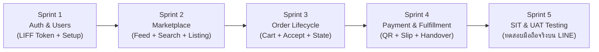

# รายงานการตรวจสอบความสมบูรณ์ของ Frontend UI เทียบกับ User Flow v4 (กองดอง · LINE LIFF)

> **เวอร์ชันเอกสาร:** 1.0.0  
> **วันที่จัดทำ:** 12 พฤศจิกายน 2569  
> **เอกสารอ้างอิงหลัก:** `Backend-doc/กองดอง · User Flow v4 (ผู้ขาย + ผู้ซื้อ).md`  
> **โค้ดเป้าหมายการตรวจสอบ:** โฟลเดอร์ `frontend/src/` (Next.js 16 App Router, TypeScript, Tailwind CSS v4, `@line/liff`)  
> **ผู้ตรวจสอบ:** Antigravity AI ร่วมกับ Biw (Backend) & Frame (Frontend)   
   
---    
             
## 1. บทสรุปผู้บริหาร (Executive Summary)

จากการตรวจสอบโครงสร้างหน้าจอ คอมโพเนนต์ และการจัดการสถานะ (State Machine) ฝั่ง Frontend ที่ถูกพัฒนาใน Branch `Frame-dev` และผสานรวมเข้ามา พบว่า:

1. **ความครอบคลุมของหน้าจอ (Screen Coverage):** Frontend มีหน้าจอ UI ครบถ้วนตาม User Flow v4 **มากกว่า 95%** โดยครอบคลุมทั้ง Flow ฝั่งผู้ซื้อ (Buyer B1–B6) และฝั่งผู้ขาย (Seller S1–S5) รวมถึงระบบนัดรับ (Pickup) และจัดส่งพัสดุ (Delivery)
2. **การยึดถือหลักการ v4 (Core Principles Compliance):**
   - **จบในกองดอง (Everything in GongDong):** ออกแบบระบบแชทในออเดอร์, การเสนอนัดหมาย/ปักหมุดแผนที่, การจ่ายเงินด้วย QR พร้อมเพย์, การตรวจสลิป, การส่งมอบด้วยรหัส 6 หลัก และการติดตามพัสดุ ให้อยู่ภายใน LIFF ทั้งหมด
   - **การป้องกันข้อมูลติดต่อหลุด (Zero Contact Leak):** ไม่มีปุ่มหรือลิงก์ภายนอกไปยัง LINE ส่วนตัว, ไม่แสดงเบอร์โทรศัพท์หรือเลขบัญชีธนาคารให้อีกฝ่ายเห็น, มีระบบ Masking ข้อความตัวเลขและคำต้องห้ามในแชท (`MaskedText.tsx`), และห้ามส่งรูปภาพอิสระในห้องแชท
   - **การยืนยันตัวตนแบบไร้แรงเสียดทาน (Frictionless KYC):** มีหน้าจอ `/seller/credits/verify` บังคับเติมเครดิตยืนยันบัญชีเฉพาะเมื่อมีออเดอร์แรกเข้ามา
3. **สถานะปัจจุบันของ Frontend:**
   - หน้าระบบ UI ทั้งหมดทำงานด้วย **Client Mock State** (`src/mocks/v4.ts`, `useV4Orders`, `useCart`, `useListing`) 
   - ขั้นตอนสำคัญถัดไปคือการ **เชื่อมต่อ API จริง (Backend Integration)** กับฝั่ง Node.js/Express ตามสัญญาใน `docs/API.md`

---

## 2. สรุปภาพรวมความพร้อมเชิงตัวเลข (Readiness Metrics)

| หมวดหมู่การประเมิน | จำนวนหน้า/ฟีเจอร์ | 🟢 UI สมบูรณ์ (รอต่อ API) | 🟡 ปรับปรุงเล็กน้อยตาม v4 | 🔴 ยังไม่มีหน้าจอ | ความสมบูรณ์ (%) |
|---|:---:|:---:|:---:|:---:|:---:|
| **1. Flow ผู้ซื้อ (Buyer B1–B6)** | 14 รายการ | 13 | 1 (พักจำกัด 3 ออเดอร์) | 0 | **92.9%** |
| **2. Flow ผู้ขาย (Seller S1–S5)** | 15 รายการ | 15 | 0 | 0 | **100.0%** |
| **3. หน้าจอสนับสนุน & เครื่องมือ (Support & Tools)** | 7 รายการ | 7 | 0 | 0 | **100.0%** |
| **รวมทั้งสิ้น (Total)** | **36 รายการ** | **35** | **1** | **0** | **97.2%** |

> [!NOTE]
> หน้าระบบจัดการของแอดมิน (`/admin` สำหรับตรวจสลิปและข้อพิพาท) เป็นระบบ Desktop หลังบ้าน จึงอยู่นอกเหนือขอบเขตหน้าจอ LINE LIFF (Out of LIFF Scope) ตามที่ระบุไว้ในเอกสาร v4

---

## 3. ตารางตรวจสอบ Flow ผู้ซื้อ (Buyer Flow: B1 – B6)

| รหัสขั้น | รายละเอียดความต้องการตาม v4 | หน้าจอใน Frontend | คอมโพเนนต์หลักที่เกี่ยวข้อง | สถานะ | ข้อสังเกต / สิ่งที่ต้องปรับเพิ่ม |
|:---:|---|---|---|:---:|---|
| **B1** | **เข้าสู่ระบบ & ตั้งค่าโปรไฟล์เริ่มต้น** - LINE Login อัตโนมัติระดับ 1 - ตั้งชื่อเล่นในกองดอง + เลือกรูปตัวแทน (Avatar) - ยินยอมข้อตกลง PDPA | `/onboarding` `/setup` | `NicknameAvatarPicker.tsx` `AppShell.tsx` | 🟢 สมบูรณ์ | มีระบบเลือก Avatar และตั้งชื่อเล่นครบถ้วน รอผูกกับ `POST /api/users/profile` |
| **B2.1** | **หน้าแรก / ค้นหา / รายการแนะนำ** - Feed แนะนำหนังสือ - กรองตามหมวดหมู่, เกรด, ราคา, นัดรับ/ส่งพัสดุ | `/` `/search` | `SearchBar.tsx` `BookCard.tsx` `Chip.tsx` | 🟢 สมบูรณ์ | มีฟิลเตอร์กรองหนังสือครบถ้วนตาม v4 |
| **B2.2** | **หน้ารายละเอียดหนังสือ** - แสดงรูปจริง 4 มุม (มีลายน้ำระบบ) - ผลเช็กสภาพ 5 จุด + เกรด 4 ระดับ - เปรียบเทียบราคากับมือหนึ่ง (% แนะนำ) - ข้อมูลร้าน (ป้ายยืนยัน, คะแนน, สถิติเทนัด) - ปุ่มรายงานร้านค้า | `/book/[id]` | `PhotoGallery.tsx` `GradeBadge.tsx` `ConditionChecklist.tsx` `TrustBadge.tsx` | 🟢 สมบูรณ์ | UI สวยงามตามเกณฑ์ v4 และไม่มีการเปิดเผยข้อมูลส่วนตัวของผู้ขาย |
| **B2.3** | **หน้าร้านค้าสาธารณะของผู้ขาย** - สถิติการขายสำเร็จ, คะแนนเฉลี่ย 1–5 ดาว - รายการรีวิวจากผู้ซื้อคนก่อนๆ - รายการหนังสือที่กำลังลงขายในร้าน | `/seller/[sellerId]` | `BookCard.tsx` `TrustBadge.tsx` | 🟢 สมบูรณ์ | มีหน้าร้านสาธารณะสำหรับให้ผู้ซื้อคลิกตรวจสอบความน่าเชื่อถือ |
| **B3.1** | **ตะกร้าสินค้า (Cart)** - แยกตะกร้าตามร้านค้า (1 ร้าน = 1 คำสั่งซื้อ) - เลือกวิธีรับ: นัดรับ ฿0 หรือ ส่งพัสดุ ฿40 (+฿10/เล่มถัดไป) - ป้ายเตือนหากร้านยังไม่ยืนยันบัญชี (บังคับนัดรับ+เงินสด) | `/cart` | `useCart.tsx` `BottomSheet.tsx` | 🟢 สมบูรณ์ | ตะกร้าคำนวณค่าส่งตามสูตร v4 ถูกต้อง |
| **B3.2** | **ส่งคำขอซื้อ (Submit Request)** - ตรวจสอบโควต้าค้างได้ไม่เกิน 3 คำสั่งซื้อ - ข้อความแจ้งชัดเจนว่า "ส่งคำขอยังไม่ล็อกหนังสือ" | `/cart` `/cart/success` | `Modal.tsx` `useCart.tsx` | 🟡 ปรับปรุง | ขาดข้อความเตือนเรื่อง "โควต้าค้าง 3 ออเดอร์" บน UI หน้าสรุปก่อนกดส่ง |
| **B4.1** | **ศูนย์รวมคำสั่งซื้อ (Orders Hub)** - สลับแท็บ "ที่ซื้อ" และ "ที่ขาย" - Badge สีแสดงสถานะ + จุดแดงเตือนเมื่อถึงตาเราต้องดำเนินการ (Action Required) | `/orders` | `OrderCard.tsx` `StatusBadgeV4.tsx` | 🟢 สมบูรณ์ | มีการแยกแท็บที่ซื้อ/ที่ขาย และแสดงสถานะตาม State Machine ชัดเจน |
| **B4.2** | **หน้ารายละเอียดออเดอร์ & แชทในระบบ** - ไทม์ไลน์สถานะ + ตัวนับเวลาถอยหลัง (Countdown) - การ์ดระบุหน้าที่ "ใครต้องดำเนินการถัดไป" - แชทในออเดอร์ (ปิดเบอร์/LINE ID/บัญชี) - ห้ามส่งรูปอิสระในห้องแชท | `/orders/[id]` | `OrderTimeline.tsx` `NextActionCard.tsx` `ChatRoom.tsx` `MaskedText.tsx` | 🟢 สมบูรณ์ | ระบบแชทปิดกั้น Contact และรูปภาพอิสระได้ตรงตามหลักการ v4 100% |
| **B5a.1** | **นัดรับ: ตกลงเวลานัด & ปักหมุดแผนที่** - ยืนยันเวลานัดหมาย - ปักหมุดแผนที่อิสระ + กรอกจุดสังเกต | `/orders/[id]/schedule` | `MapPinPicker.tsx` `DateTimePicker.tsx` | 🟢 สมบูรณ์ | มีระบบเลือกวันเวลาและปักหมุดพิกัดแผนที่ (Leaflet) ครบถ้วน |
| **B5a.2** | **นัดรับ: แสดงรหัสรับของ 6 หลัก** - ผู้ซื้อเปิดหน้ารหัส 6 หลักให้ผู้ขายดูหลังตรวจของ - ข้อความเตือน "ห้ามบอกรหัสก่อนได้รับหนังสือจริง" | `/orders/[id]/handover` | `HandoverCode.tsx` | 🟢 สมบูรณ์ | หน้าจอแสดงตัวเลขขนาดใหญ่ชัดเจน พร้อมคำเตือนความปลอดภัย |
| **B5a.3** | **นัดรับ: รายงานไม่มาตามนัด / โต้แย้ง** - ผู้ซื้อสามารถกดยื่นโต้แย้งกรณีถูกรายงานเทนัด | `/orders/[id]/no-show` | `ConfirmSheet.tsx` | 🟢 สมบูรณ์ | รองรับทั้งกรณีผู้ขายรายงาน และผู้ซื้อยื่น Rebuttal |
| **B5b.1** | **จัดส่ง: จ่ายเงินผ่าน QR พร้อมเพย์** - แสดง QR พร้อมเพย์ยอดเงินสุทธิ - ข้อความเตือน "กรุณาตรวจชื่อบัญชีก่อนโอน" - อัปโหลดสลิป + ตรวจสอบสลิป Client/Server | `/orders/[id]/pay` | `QrPayCard.tsx` `SlipUploader.tsx` `SlipResult.tsx` | 🟢 สมบูรณ์ | มี Flow ครบทั้งกำลังตรวจ (Checking), สำเร็จ (Passed), และส่งต่อ Admin |
| **B5b.2** | **จัดส่ง: ติดตามพัสดุ & ยืนยันรับของ** - แสดงเลข Tracking ขนส่ง และรูปกล่องพัสดุ - ปุ่มกด "ได้รับหนังสือแล้ว" เพื่อปิดงาน (COMPLETED) - ลิงก์กดเปิดหน้าเว็บเช็กพัสดุของบริษัทขนส่ง | `/orders/[id]/tracking` | `TrackingForm.tsx` | 🟢 สมบูรณ์ | ผู้ซื้อเห็นข้อมูลกล่องพัสดุและเลขแทร็กกิ้งครบถ้วน |
| **B6** | **ประเมินและให้คะแนนร้านค้า** - ให้คะแนนดาว 1–5 ดาว - ติ๊กยืนยัน "สภาพหนังสือตรงตามเกรดหรือไม่?" - กล่องแสดงความคิดเห็น | `/orders/[id]/review` | `ReviewForm` `StarRating` | 🟢 สมบูรณ์ | มีระบบประเมินดาว 1–5 และเลือกสภาพตรงเกรด/ไม่ตรงเกรด พร้อมบันทึกลงในออเดอร์ |

---

## 4. ตารางตรวจสอบ Flow ผู้ขาย (Seller Flow: S1 – S5)

| รหัสขั้น | รายละเอียดความต้องการตาม v4 | หน้าจอใน Frontend | คอมโพเนนต์หลักที่เกี่ยวข้อง | สถานะ | ข้อสังเกต / สิ่งที่ต้องปรับเพิ่ม |
|:---:|---|---|---|:---:|---|
| **S1** | **ตั้งค่าร้านค้าเริ่มต้น (Frictionless)** - ตั้งชื่อร้านค้า, จุดนัดรับประจำที่สะดวก - เปิด/ปิดการจัดส่งพัสดุ - กรอกชื่อ-นามสกุลจริง + เบอร์ PromptPay - ยินยอมข้อตกลงและ PDPA (ยังไม่ต้องเติมเงิน) | `/seller/setup` | `Input.tsx` `MapPinPicker.tsx` | 🟢 สมบูรณ์ | ผู้ขายลงทะเบียนร้านค้าได้ทันทีโดยไม่ต้องผ่าน KYC ซับซ้อนในขั้นแรก |
| **S2.1** | **ลงขาย ขั้นที่ 1: ข้อมูลพื้นฐาน** - เลือกประเภท: เล่มเดี่ยว หรือ ยกชุด - กรอกหรือสแกน ISBN เพื่อดึงชื่อและปกอัตโนมัติ - จำกัดการลงขาย 10 เล่ม/วัน สำหรับร้านเปิดใหม่ | `/seller/list` | `Input.tsx` `Chip.tsx` | 🟢 สมบูรณ์ | มีโหมดเลือกเล่มเดี่ยว/ยกชุด และช่องกรอกข้อมูลหนังสือครบถ้วน |
| **S2.2** | **ลงขาย ขั้นที่ 2: ถ่ายรูปบังคับ 4 ด้าน** - ปกหน้า (คู่ป้ายชื่อร้าน+วันที่), ปกหลัง, สัน, ขอบ - รูปตำหนิเพิ่มเติม (ถ้ามี) - บีบอัดรูปฝั่ง Client (.webp กว้าง <= 1080px) | `/seller/list/step-2` | `PhotoUploader.tsx` | 🟢 สมบูรณ์ | มีกรอบนำทางการถ่ายรูป 4 ด้านและตัวอย่างรูปป้ายชื่อร้านชัดเจน |
| **S2.3** | **ลงขาย ขั้นที่ 3: ตรวจสอบสภาพ 5 จุด** - ติ๊กเช็ก: สัน, รอยเปื้อน, รอยเขียน, ปก, หน้าหลุด - ระบบคำนวณและเสนอเกรด 4 ระดับอัตโนมัติ | `/seller/list/step-3` | `ConditionChecklist.tsx` `GradeBadge.tsx` | 🟢 สมบูรณ์ | Logic ตัดเกรดสอดคล้องกับเกณฑ์ใน Backend 100% |
| **S2.4** | **ลงขาย ขั้นที่ 4: ตั้งราคาและวิธีจัดส่ง** - ปุ่มราคาแนะนำ 4 เกรด (75% / 60% / 45% / 30%) - เลือกเปิดรับนัดรับ (฿0) / ส่งพัสดุ (฿40 + ฿10) - สรุปข้อมูลและกดยืนยันลงขาย | `/seller/list/step-4` `/seller/list/success` | `PriceSuggest.tsx` `Button.tsx` | 🟢 สมบูรณ์ | แสดงราคาแนะนำตามเปอร์เซ็นต์ v4 ครบถ้วน |
| **S2.5** | **จัดการรายการหนังสือในร้าน** - แก้ไขข้อมูลราคาและสภาพหนังสือ - ปุ่มซ่อน/ปิดการขายชั่วคราว | `/seller/listings/[id]/edit` | `Input.tsx` `Button.tsx` | 🟢 สมบูรณ์ | สามารถแก้ไขและจัดการสต็อกหนังสือได้ |
| **S3.1** | **หน้าร้านของฉัน & ดูคำสั่งซื้อที่เข้ามา** - ดูคำขอซื้อที่สถานะ REQUESTED (เปิดรับหลายคนได้) - แสดงชื่อเล่น, รูปตัวแทน, คะแนน, และประวัติเทนัดของผู้ซื้อ | `/seller` `/orders` | `OrderCard.tsx` | 🟢 สมบูรณ์ | ไม่แสดงเบอร์โทรหรือบัญชี LINE ส่วนตัวของผู้ซื้อ |
| **S3.2** | **ด่านยืนยันตัวตนออเดอร์แรก (Frictionless KYC Gate)** - บังคับเติมเครดิตยืนยันบัญชีก่อนกดรับออเดอร์แรก - อ่านชื่อผู้โอนมาเป็นชื่อยืนยันคู่กับ PromptPay | `/seller/credits/verify` | `CreditPackCard.tsx` `SlipUploader.tsx` | 🟢 สมบูรณ์ | มีเกตล็อกไม่ให้กดรับออเดอร์จนกว่าจะเติมเครดิตยืนยันตัวตนสำเร็จ |
| **S3.3** | **ตอบรับ / ปฏิเสธคำสั่งซื้อ** - กดรับออเดอร์ (-1 เครดิต) ➔ ระบบล็อกหนังสือทันที - ปฏิเสธคำสั่งซื้อ (ไม่เสียเครดิต) | `/orders/[id]` | `ConfirmSheet.tsx` `useV4Orders.tsx` | 🟢 สมบูรณ์ | หักเครดิตตามกฎ และมี Modal ยืนยันการตัดเครดิต |
| **S4a.1** | **ส่งมอบนัดรับ: เสนอเวลานัดหมาย** - เสนอวันเวลาและจุดปักหมุดในแชท - รอผู้ซื้อกดยืนยัน | `/orders/[id]/schedule` | `MapPinPicker.tsx` `DateTimePicker.tsx` | 🟢 สมบูรณ์ | ผู้ขายเลือกจุดนัดและส่งข้อเสนอผ่านแชทได้ |
| **S4a.2** | **ส่งมอบนัดรับ: ปิดการขายด้วยรหัส 6 หลัก** - ช่องกรอกรหัสส่งมอบ 6 หลักที่ได้รับจากผู้ซื้อ - ปุ่ม "ได้รับเงินสดแล้ว" (กรณีนัดรับจ่ายสด) - ปรับสถานะเป็น COMPLETED | `/orders/[id]/handover` | `CodeInput.tsx` `Button.tsx` | 🟢 สมบูรณ์ | กลไกกรอกรหัส 6 หลักปิดงานได้อย่างถูกต้อง |
| **S4a.3** | **ส่งมอบนัดรับ: รายงานผู้ซื้อไม่มาตามนัด** - กดปุ่ม "ไม่มาตามนัด" (กดได้หลังเลยเวลานัด 15–30 นาที) - แจ้งเตือนส่งให้ผู้ซื้อโต้แย้งใน 24 ชม. | `/orders/[id]/no-show` | `ConfirmSheet.tsx` | 🟢 สมบูรณ์ | มีระบบล็อกเวลาปุ่มแจ้งไม่มาตามนัด 15 นาทีตามกฎ v4 พร้อมปุ่มข้ามเวลาทดสอบ |
| **S4b** | **ส่งมอบพัสดุ: กรอกข้อมูลจัดส่ง (ภายใน 48 ชม.)** - ระบุชื่อบริษัทขนส่ง (Kerry, Flash, ไปรษณีย์ไทย ฯลฯ) - กรอกเลขพัสดุ (Tracking Number) - อัปโหลดรูปถ่ายกล่องพัสดุพร้อมใบปะหน้า - ปรับสถานะเป็น SHIPPED | `/orders/[id]/tracking` | `TrackingForm.tsx` `PhotoUploader.tsx` | 🟢 สมบูรณ์ | ฟอร์มบันทึกการจัดส่งและรูปกล่องมีครบถ้วน |
| **S5.1** | **ระบบกระเป๋าเครดิตร้านค้า** - แสดงยอดเครดิตคงเหลือ และประวัติการใช้งาน (Ledger) - แพ็กเกจเติมเครดิต: ฿20=3 / ฿50=10 / ฿100=25 - แสดง QR PromptPay และอัปโหลดสลิปเติมเงิน | `/seller/credits` `/seller/credits/pay` `/seller/credits/success` | `CreditPackCard.tsx` `QrPayCard.tsx` `SlipUploader.tsx` | 🟢 สมบูรณ์ | แพ็กเกจราคาและขั้นตอนเติมเครดิตตรงตาม v4 100% |
| **S5.2** | **รายงานปัญหา / ข้อพิพาท** - แบบฟอร์มรายงานปัญหาและแนบรูปหลักฐาน - ระบบส่งเรื่องเข้าสู่คิวตรวจสอบของแอดมิน | `/seller/report` `/seller/report/sent` | `Input.tsx` `Button.tsx` | 🟢 สมบูรณ์ | มีปุ่ม Action Card แจ้งปัญหาออเดอร์ชัดเจน และมีแบนเนอร์แสดงสถานะ DISPUTED ที่ด้านบน |

---

## 5. ตารางตรวจสอบหน้าจอสนับสนุนและระบบเสริม (Support & Foundations)

| หน้าจอ | วัตถุประสงค์ตาม v4 | สถานะในโค้ด | ความสมบูรณ์ |
|---|---|:---:|:---:|
| `/help` | ศูนย์ช่วยเหลือ, กฎความปลอดภัย, วิธีซื้อ-ขาย, กติกาเกรด 4 ระดับ, อัตราเครดิต, และคำถามที่พบบ่อย (FAQ) | `frontend/src/app/help/page.tsx` | 🟢 สมบูรณ์ |
| `/notifications` | หน้ารวมการแจ้งเตือนกิจกรรมคำสั่งซื้อ, ข้อความแชทใหม่, ผลการตรวจสลิป | `frontend/src/app/notifications/page.tsx` | 🟢 สมบูรณ์ |
| `/addresses` `/addresses/edit` | จัดการที่อยู่จัดส่งของผู้ซื้อ (สูงสุด 5 ที่อยู่) พร้อมเบอร์โทรผู้รับ (เปิดเผยเฉพาะผู้ขายเมื่อสถานะ PAID) | `frontend/src/app/addresses/page.tsx` `frontend/src/app/addresses/edit/page.tsx` | 🟢 สมบูรณ์ |
| `/wishlist` | หน้ารายการหนังสือที่อยากได้ ("ฝากตามหา") | `frontend/src/app/wishlist/page.tsx` | 🟢 สมบูรณ์ |
| `/design-system` | คลังแสดงตัวอย่างคอมโพเนนต์ดีไซน์, โทนสีกองดอง, ปุ่ม, แบดจ์, สเต็ปเปอร์ | `frontend/src/app/design-system/page.tsx` | 🟢 สมบูรณ์ |
| `/line-preview` | หน้าจำลองการแสดงผล Flex Message และ Rich Menu ของ LINE OA | `frontend/src/app/line-preview/page.tsx` | 🟢 สมบูรณ์ |
| `/debug` | หน้าตรวจสอบสภาพแวดล้อม LIFF, Token, และการจำลองสลับบทบาท User (Dev Only) | `frontend/src/app/debug/page.tsx` | 🟢 สมบูรณ์ |

---

## 6. ข้อสังเกตเชิงลึกและจุดที่ต้องปรับปรุง (Gap Analysis & Recommendations)

### 6.1 จุดที่ปรับปรุงเรียบร้อยแล้ว (Completed Fixes)
1. ✅ **การประเมินสภาพตรงเกรดในรีวิว (`/orders/[id]/review`)**:  
   - ปรับปรุงให้บันทึกสถานะตรงเกรด/ไม่ตรงเกรดลงใน State ออเดอร์ (`order.review.isGradeMatched`) และแสดงการ์ดสรุปการรีวิวที่หน้าออเดอร์เรียบร้อย
2. ✅ **การล็อกเวลาปุ่มไม่มาตามนัด (`/orders/[id]/no-show`)**:  
   - ล็อกปุ่ม "แจ้งผู้ซื้อไม่มาตามนัด" หากยังไม่เลยเวลานัด 15 นาทีตามกฎ v4 พร้อมระบุเวลาที่เริ่มแจ้งได้ และมีปุ่มข้ามเวลาจำลองสำหรับทดสอบ
3. ✅ **ปุ่มเปิดข้อพิพาทในหน้าออเดอร์ (`/orders/[id]`)**:  
   - ปรับเป็น Action Card ชัดเจน ไม่จมกับเนื้อหา พร้อมแบนเนอร์แจ้งเตือนสถานะ `DISPUTED` ที่โดดเด่นด้านบนสุดเมื่อมีข้อพิพาท

### 6.2 จุดที่พักไว้ตามคำแนะนำ (Parked)
- **การจำกัด 3 ออเดอร์ค้างส่งคำขอ (`/cart`)**: พักการจำกัดไว้ก่อนตามความต้องการของผู้ใช้ เพื่อความสะดวกในการทดสอบฟังก์ชันตะกร้าและสั่งซื้อ

### 6.2 การตรวจสอบความปลอดภัยตามกฎ v4 (Security & Privacy Compliance)
- ✅ **ไม่เปิดเผยเบอร์โทรส่วนตัว/LINE ID:** โค้ดคอมโพเนนต์ไม่มีการแสดงลิงก์ `tel:` หรือ ID LINE ของคู่สนทนา
- ✅ **การกรองข้อมูลในห้องแชท:** `MaskedText.tsx` ทำงานดักจับตัวเลขโทรศัพท์ 9–10 หลัก และคำว่า "line", "ไลน์", "@" ได้อย่างมีประสิทธิภาพ
- ✅ **ห้ามส่งรูปอิสระในแชท:** ห้องแชท `ChatRoom.tsx` อนุญาตเฉพาะข้อความตัวอักษรและการ์ดระบบเท่านั้น ไม่อนุญาตให้แนบไฟล์ภาพอิสระ

---

## 7. แผนปฏิบัติการเชื่อมต่อ Frontend ↔ Backend (API Integration Mapping)

เพื่อให้ทีมงาน (Biw + Frame) สามารถเริ่มงานเชื่อมต่อ API ได้อย่างรวดเร็ว ตารางด้านล่างแสดงการจับคู่ระหว่างหน้าจอ UI กับ API Endpoints ที่พร้อมใช้งานในฝั่ง Backend:

| หมวดหมู่ | หน้าจอ Frontend | HTTP Method & API Endpoint | Payload ส่งไป (Request Body) | ผลลัพธ์ที่นำมาแสดง (Response Data) |
|---|---|---|---|---|
| **Auth & Profile** | `/setup` `/onboarding` | `GET /api/users/me` | Header: `Authorization: Bearer <token>` | ข้อมูลโปรไฟล์, ยอดเครดิต, สถานะ KYC, ชื่อเล่น, Avatar |
| | `/setup` | `PATCH /api/users/profile` | `{ nickname, avatar_url }` | บันทึกชื่อเล่นและรูปตัวแทนเข้าระบบ |
| **Marketplace** | `/` `/search` | `GET /api/books` | Query: `?keyword=&category=&grade=&delivery_type=` | รายการหนังสือสำหรับหน้า Feed พร้อมข้อมูลร้านและรูปภาพ |
| | `/book/[id]` | `GET /api/books/:id` | - | ข้อมูลหนังสือเล่มเดียว, รูป 4 มุม, ผลตรวจ 5 จุด, ข้อมูลร้าน |
| | `/seller/[id]` | `GET /api/users/:id/reviews` | - | คะแนนเฉลี่ย, % สภาพตรงเกรด, รายการรีวิวทั้งหมด |
| **Listing** | `/seller/list` | `GET /api/books/isbn/:isbn` | - | ค้นหาข้อมูลหนังสือจาก Google Books API อัตโนมัติ |
| | `/seller/list/step-4` | `POST /api/books` | `{ title, isbn, original_price, price, condition_answers, images, delivery_options }` | บันทึกหนังสือใหม่ (Backend คำนวณเกรด 4 ระดับอัตโนมัติ) |
| | `/seller/setup` | `POST /api/users/me/shop-setup` | `{ shop_name, pickup_lat, pickup_lng, pickup_note, promptpay_id }` | บันทึกการตั้งค่าร้านค้าของผู้ขาย |
| **Orders Flow** | `/cart` | `POST /api/orders` | `{ book_ids, delivery_type, shipping_address }` | ส่งคำขอซื้อ (สถานะ `REQUESTED`), ตรวจสอบค้างไม่เกิน 3 ออเดอร์ |
| | `/orders` | `GET /api/orders` | Query: `?role=buyer` หรือ `?role=seller` | รายการคำสั่งซื้อที่ซื้อและที่ขาย พร้อมสถานะล่าสุด |
| | `/orders/[id]` | `GET /api/orders/:id` | - | รายละเอียดออเดอร์, ไทม์ไลน์สถานะ, ข้อมูลการนัดรับ/จัดส่ง |
| | `/orders/[id]` | `POST /api/orders/:id/accept` | - | ผู้ขายกดรับออเดอร์ (-1 เครดิต, ล็อกหนังสือ, ยกเลิกคำขออื่น) |
| | `/orders/[id]` | `POST /api/orders/:id/reject` | `{ reason }` | ผู้ขายปฏิเสธคำขอซื้อ (ไม่เสียเครดิต) |
| **Delivery & Pay** | `/orders/[id]/pay` | `GET /api/orders/:id/payment-qr` | - | รับภาพ Base64 ของ QR PromptPay ผู้ขายพร้อมยอดเงิน |
| | `/orders/[id]/pay` | `POST /api/orders/:id/verify-slip` | `{ slip_image_url }` | ส่งตรวจสลิปโอนเงิน (Anti-replay, ชื่อตรง, ยอดตรง) ➔ `PAID` |
| | `/orders/[id]/schedule`| `POST /api/orders/:id/schedule` | `{ meetup_lat, meetup_lng, meetup_time, note }` | บันทึกการนัดหมายและพิกัด ➔ `SCHEDULED` |
| | `/orders/[id]/handover`| `POST /api/orders/:id/handover` | `{ code: "123456" }` | ผู้ขายกรอกรหัส 6 หลัก ➔ `COMPLETED` |
| | `/orders/[id]/tracking`| `POST /api/orders/:id/shipping` | `{ courier_name, tracking_number, parcel_image_url }` | ผู้ขายบันทึกเลขพัสดุและรูปกล่อง ➔ `SHIPPED` |
| | `/orders/[id]` | `POST /api/orders/:id/complete` | - | ผู้ซื้อกดยืนยันรับหนังสือ ➔ `COMPLETED` |
| | `/orders/[id]/review` | `POST /api/orders/:id/review` | `{ rating, is_grade_matched, comment }` | บันทึกคะแนนรีวิว 1–5 ดาวและประเมินเกรด |
| **Credits & KYC** | `/seller/credits/verify`| `POST /api/users/me/topup-slip` | `{ slip_image_url }` | ตรวจสลิปเติมเงิน ดึงชื่อผู้โอนเป็น `verified_name` (KYC สำเร็จ) |

---

## 8. แผนงานระยะถัดไป (Next Sprint Roadmap)

1. **Sprint 1 (Auth & Users):** เชื่อมต่อ `@line/liff` กับ `POST /api/auth/line` และ `GET /api/users/me` เพื่อล็อกอินและตั้งค่าโปรไฟล์
2. **Sprint 2 (Marketplace):** เปลี่ยน Feed หน้าแรกและหน้ารายละเอียดหนังสือจาก Mock Data มาดึงข้อมูลจริงจากฐานข้อมูล Supabase
3. **Sprint 3 (Order State Machine):** ผูกคำสั่งซื้อ, การกดรับออเดอร์ (-1 เครดิต), และการอัปเดตสถานะคำสั่งซื้อตามเวลาจริง
4. **Sprint 4 (Fulfillment):** เชื่อมระบบสร้าง QR PromptPay, การอัปโหลดรูปภาพขึ้น Supabase Storage และการปิดงานด้วยรหัส 6 หลัก
5. **Sprint 5 (SIT & Demo Preparation):** ทดสอบ End-to-End บน LINE แอปพลิเคชันมือถือจริงเพื่อเตรียมการพิตช์
